# A showcase of the main tna functions

## Tutorial of TNA with R

This is a short tutorial of the `tna` package. We begin by loading the
package and the example data set `group_regulation`.

``` r

library("tna")
data("group_regulation", package = "tna")
```

### Building `tna` Model

TNA models can be built with the `tna` function, which accepts several
types of data such a sequence data, data frames or matrices.

``` r

model <- tna(group_regulation)
print(model)
```

### Plotting and interpreting `tna` models

#### Interpretation of the model

The nodes are the states and the arrows the transition probabilities
between them; the filled share of the ring (donut) around each node is
its initial probability. The thicker an arrow, the more likely the
process moves from one state to the other.

``` r

# TNA visualization
plot(model)
#> Registered S3 method overwritten by 'cograph':
#>   method             from
#>   plot.tna_bootstrap tna
```

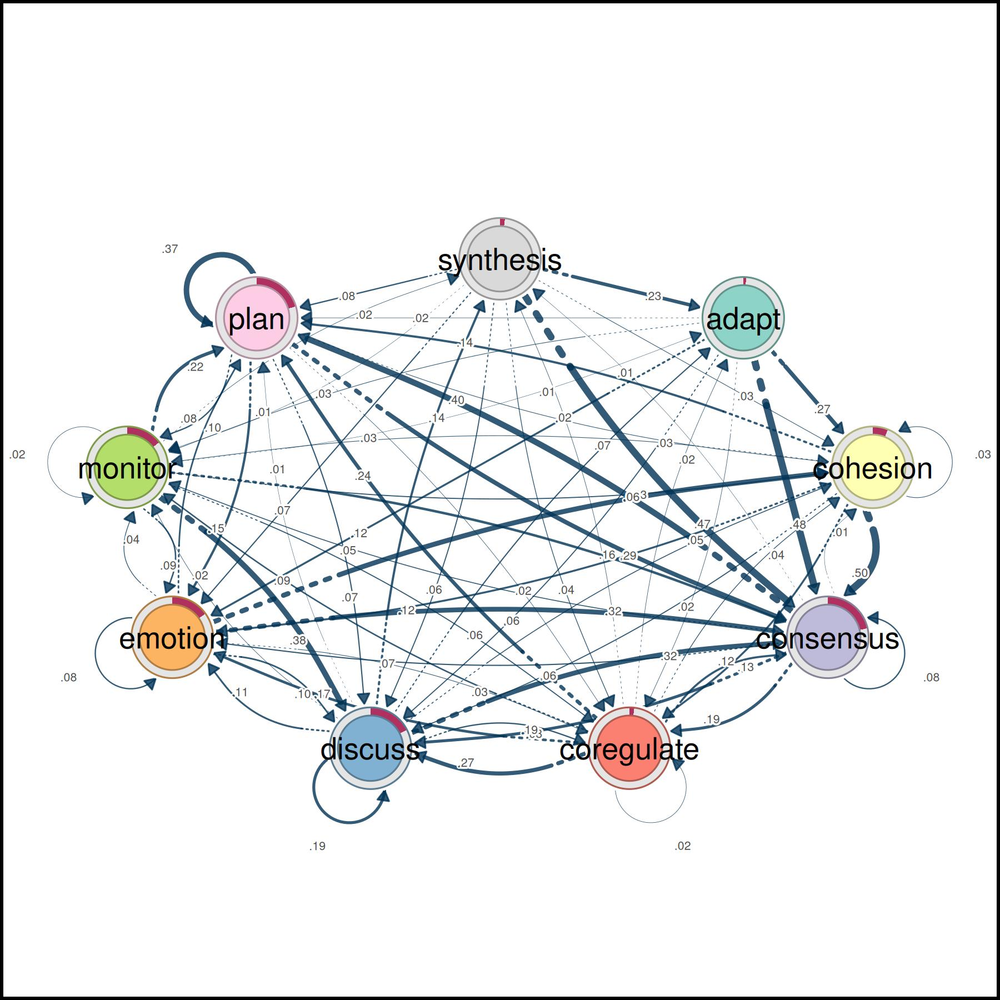

#### Pruning and retaining edges that “matter”

A transition network estimated from sequences has an edge for almost
every observed pair of states, and most of them are rare. Pruning
removes the weakest edges so that the backbone of the process is
visible. The three methods differ in how they define weak: a fixed
weight (`threshold`), a share of the weakest edges (`lowest`), or edges
that are not significant relative to the other edges of the same state
(`disparity`). The unpruned model is plotted last for reference.

``` r

layout(matrix(1:4, ncol = 2, byrow = TRUE))
# Pruning with different methods (using comparable parameters)
pruned_threshold <- prune(model, method = "threshold", threshold = 0.15)
pruned_lowest <- prune(model, method = "lowest", lowest = 0.15)
pruned_disparity <- prune(model, method = "disparity", level = 0.5)

# Plotting for comparison
plot(pruned_threshold)
plot(pruned_lowest)
plot(pruned_disparity)
plot(model)
```

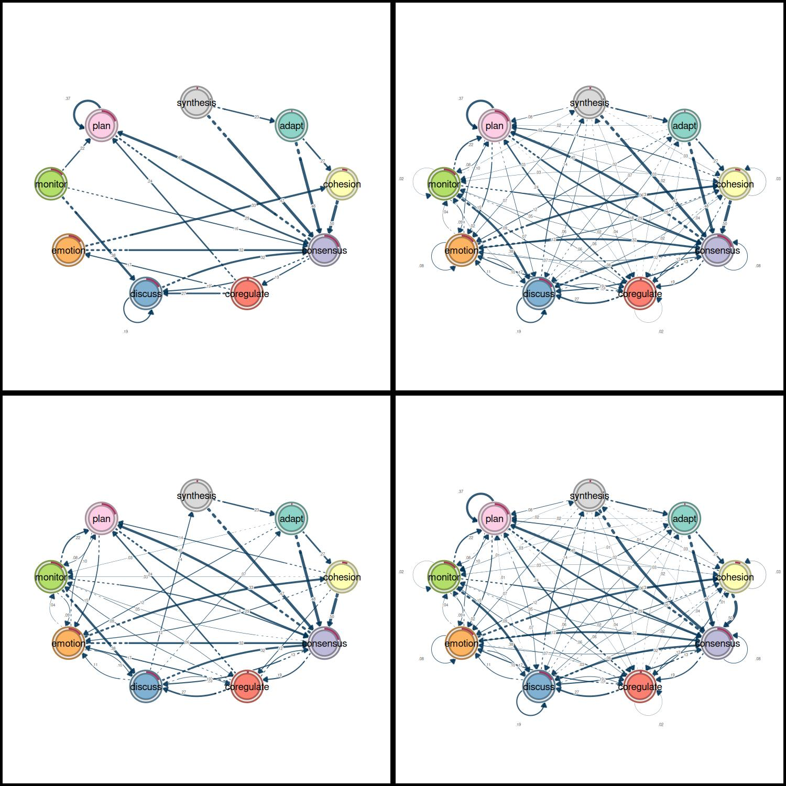

### Patterns

Cliques are groups of states that are all connected with each other in
both directions, above a minimum weight. They show the states that the
process moves back and forth between.

``` r

layout(t(1:2))
# Identify 2-cliques (dyads) from the TNA model, excluding loops in the visualization
# A clique of size 2 is essentially a pair of connected nodes
cliques_of_two <- cliques(
  model, 
  size = 2, 
  threshold = 0.15  # Only consider edges with weight >= 0.15
)
print(cliques_of_two)
#> Number of 2-cliques = 2 (weight threshold = 0.15)
#> Showing 2 cliques starting from clique number 1
#> 
#> Clique 1
#>           consensus plan
#> consensus     0.082 0.40
#> plan          0.290 0.37
#> 
#> Clique 2
#>           consensus discuss
#> consensus     0.082    0.19
#> discuss       0.321    0.19
plot(cliques_of_two, ask = FALSE)
```

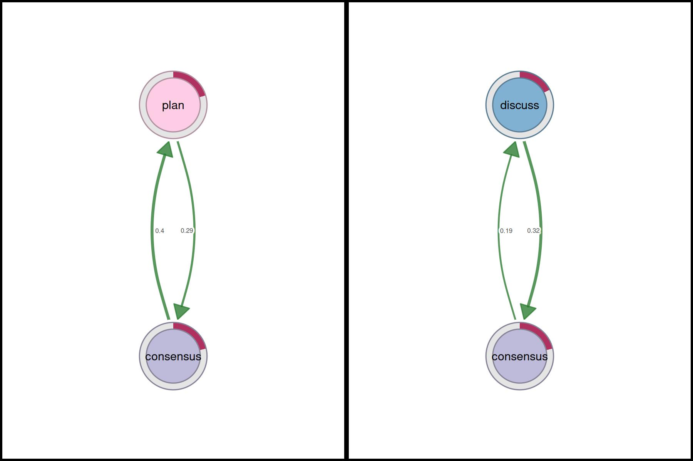

``` r

layout(t(1:3))
# Identify 3-cliques (triads) from the TNA_Model
# A clique of size 3 means a fully connected triplet of nodes
cliques_of_three <- cliques(
  model, 
  size = 3, 
  threshold = 0.05 # Only consider edges with weight >= 0.05
)
print(cliques_of_three)
#> Number of 3-cliques = 3 (weight threshold = 0.05)
#> Showing 3 cliques starting from clique number 1
#> 
#> Clique 1
#>           consensus discuss emotion
#> consensus     0.082    0.19   0.073
#> discuss       0.321    0.19   0.106
#> emotion       0.320    0.10   0.077
#> 
#> Clique 2
#>           consensus emotion plan
#> consensus     0.082   0.073 0.40
#> emotion       0.320   0.077 0.10
#> plan          0.290   0.147 0.37
#> 
#> Clique 3
#>            consensus coregulate discuss
#> consensus      0.082      0.188    0.19
#> coregulate     0.135      0.023    0.27
#> discuss        0.321      0.084    0.19
plot(cliques_of_three, ask = FALSE)
```

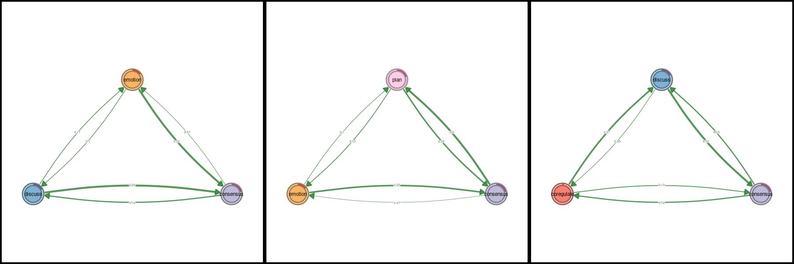

``` r

# Identify 4-cliques (quadruples) from the TNA_Model
# A clique of size 4 means four nodes that are all mutually connected
cliques_of_four <- cliques(
  model, 
  size = 4, 
  threshold = 0.035 # Only consider edges with weight >= 0.035
)
print(cliques_of_four)
#> Number of 4-cliques = 1 (weight threshold = 0.035)
#> Showing 1 cliques starting from clique number 1
#> 
#> Clique 1
#>           consensus emotion monitor plan
#> consensus     0.082   0.073   0.047 0.40
#> emotion       0.320   0.077   0.036 0.10
#> monitor       0.159   0.091   0.018 0.22
#> plan          0.290   0.147   0.076 0.37
plot(cliques_of_four, ask = FALSE)
```

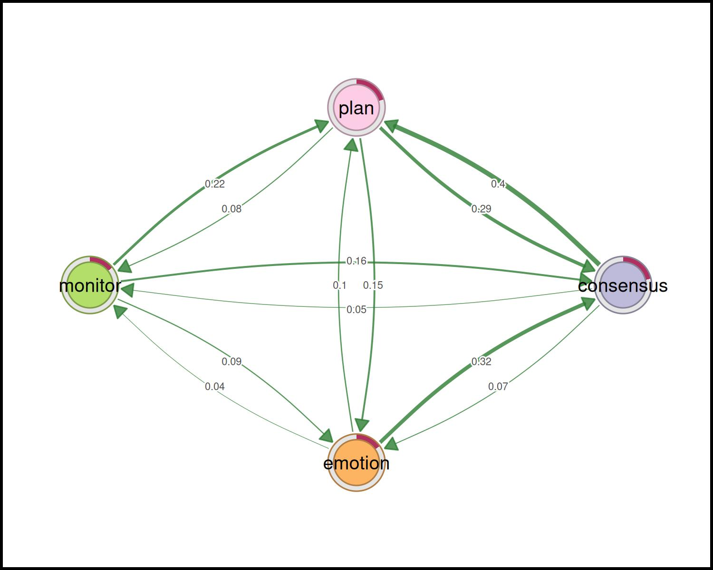

#### Centralities

##### Node-level measures

``` r

# Compute centrality measures for the TNA model
Centralities <- centralities(model)

# Visualize the centrality measures
plot(Centralities)
```

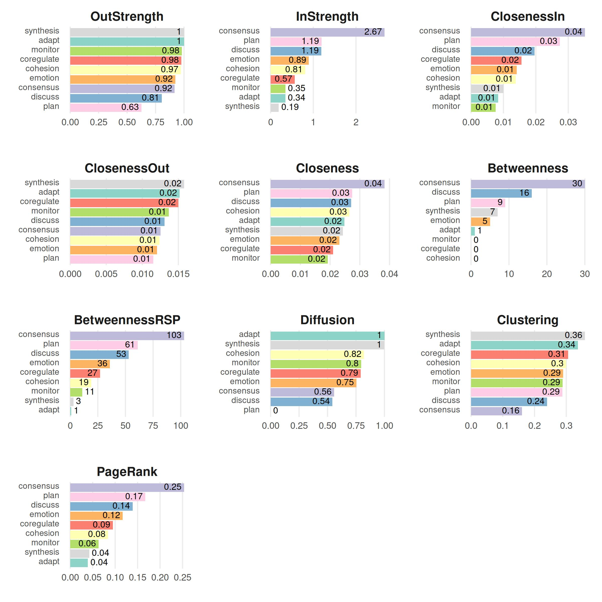

Other measures can be computed with `igraph` after converting the model
with [`as.igraph()`](https://r.igraph.org/reference/as.igraph.html). The
hub score of a state is high when it leads to states with high authority
scores, which in turn are the states that many hubs lead to.

``` r

# Calculate hub scores and the authority scores for the network
hits_scores <- igraph::hits_scores(as.igraph(model))

# Print the calculated hub and authority scores (and the eigenvalue)
print(hits_scores)
#> $hub
#>      adapt   cohesion  consensus coregulate    discuss    emotion    monitor 
#>       0.96       1.00       0.65       0.69       0.74       0.82       0.74 
#>       plan  synthesis 
#>       0.87       0.90 
#> 
#> $authority
#>      adapt   cohesion  consensus coregulate    discuss    emotion    monitor 
#>      0.122      0.301      1.000      0.195      0.439      0.333      0.122 
#>       plan  synthesis 
#>      0.511      0.059 
#> 
#> $value
#> [1] 1.6
#> 
#> $options
#> $options$bmat
#> [1] "I"
#> 
#> $options$n
#> [1] 9
#> 
#> $options$which
#> [1] "LA"
#> 
#> $options$nev
#> [1] 1
#> 
#> $options$tol
#> [1] 0
#> 
#> $options$ncv
#> [1] 0
#> 
#> $options$ldv
#> [1] 0
#> 
#> $options$ishift
#> [1] 1
#> 
#> $options$maxiter
#> [1] 3000
#> 
#> $options$nb
#> [1] 1
#> 
#> $options$mode
#> [1] 1
#> 
#> $options$start
#> [1] 1
#> 
#> $options$sigma
#> [1] 0
#> 
#> $options$sigmai
#> [1] 0
#> 
#> $options$info
#> [1] 0
#> 
#> $options$iter
#> [1] 3
#> 
#> $options$nconv
#> [1] 1
#> 
#> $options$numop
#> [1] 12
#> 
#> $options$numopb
#> [1] 0
#> 
#> $options$numreo
#> [1] 11
```

##### Edge-level measures

``` r

# Edge betweenness
Edge_betweeness <- betweenness_network(model)
plot(Edge_betweeness)
```

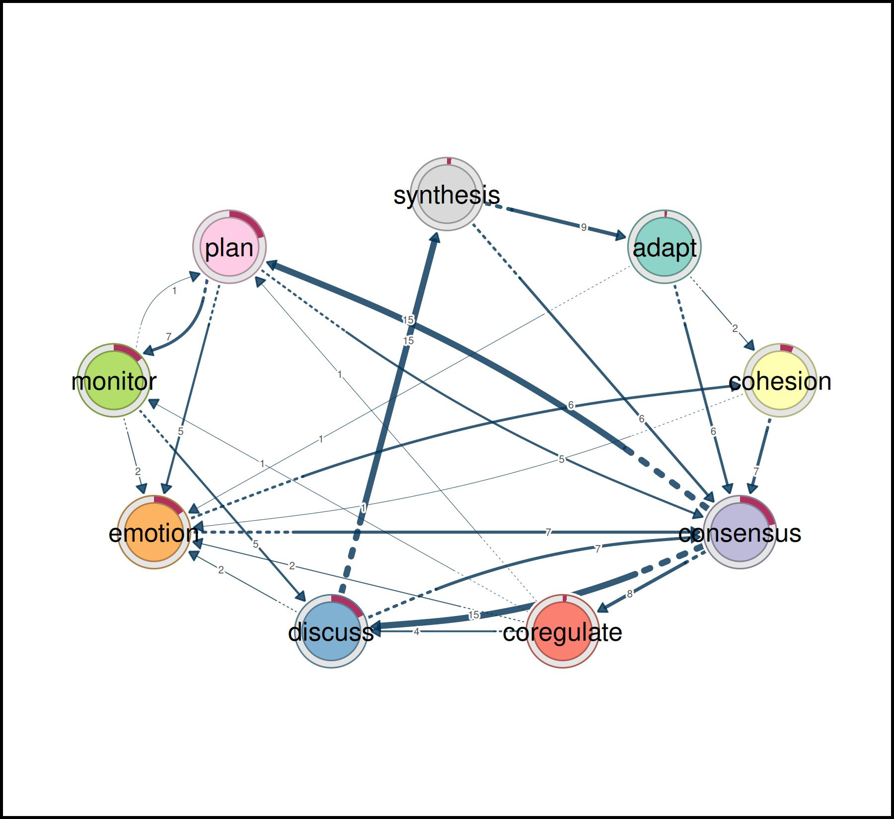

#### Community finding

``` r

communities <- communities(model)
print(communities)
#> Number of communities found by each algorithm
#> 
#>         walktrap      fast_greedy       label_prop          infomap 
#>                1                3                1                1 
#> edge_betweenness    leading_eigen        spinglass 
#>                1                3                2 
#> 
#> Community assignments
#> 
#>       state walktrap fast_greedy label_prop infomap edge_betweenness leading_eigen
#> 1     adapt        1           1          1       1                1             1
#> 2  cohesion        1           1          1       1                1             1
#> 3 consensus        1           1          1       1                1             2
#>   spinglass
#> 1         1
#> 2         1
#> 3         1
#>  [ reached 'max' / getOption("max.print") -- omitted 6 rows ]
plot(communities, method = "leading_eigen")
```

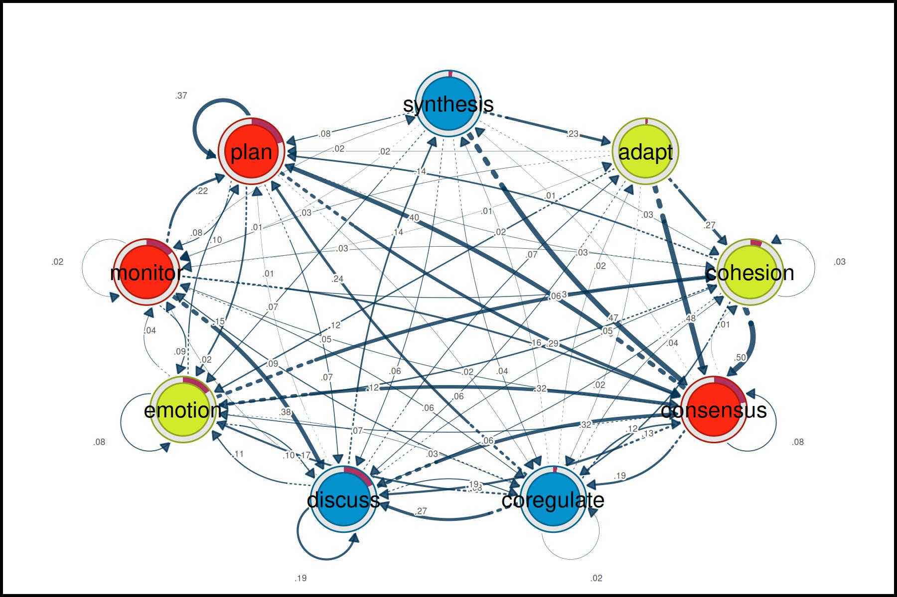

### Network inference

#### Bootstrapping

An edge estimated from one sample of sequences can be large by chance.
The bootstrap resamples the sequences and tests, for every edge, whether
its weight stays within a consistency range around the observed weight
(by default 75% to 125%) in at least 95% of the resamples.

``` r

# Perform bootstrapping on the TNA model with a fixed seed for reproducibility
set.seed(265)
boot <- bootstrap(model)

# Print a summary of the bootstrap results
print(summary(boot))
#>         from    to weight p_value   sig cr_lower cr_upper ci_lower ci_upper
#> 2   cohesion adapt 0.0029    0.51 FALSE   0.0022   0.0037  0.00059   0.0054
#> 3  consensus adapt 0.0047    0.16 FALSE   0.0036   0.0059  0.00313   0.0065
#> 4 coregulate adapt 0.0162    0.15 FALSE   0.0122   0.0203  0.01078   0.0222
#>  [ reached 'max' / getOption("max.print") -- omitted 75 rows ]

# Show the non-significant edges (p-value >= 0.05, the default level)
# These are edges that are less likely to be stable across bootstrap samples
print(boot, type = "nonsig")
#> Non-significant Edges
#> 
#>         from    to weight p_value cr_lower cr_upper ci_lower ci_upper
#> 2   cohesion adapt 0.0029    0.51   0.0022   0.0037  0.00059   0.0054
#> 3  consensus adapt 0.0047    0.16   0.0036   0.0059  0.00313   0.0065
#> 4 coregulate adapt 0.0162    0.15   0.0122   0.0203  0.01078   0.0222
#>  [ reached 'max' / getOption("max.print") -- omitted 24 rows ]
```

#### Permutation

A difference between the networks of two groups is only evidence of a
group difference if it is larger than the differences that arise when
the sequences are assigned to the groups at random. The permutation test
reassigns the sequences many times and gives a p-value for the
difference of every edge, and of the requested centralities.

``` r

# Create TNA for the high-achievers subset (rows 1 to 1000)
Hi <- tna(head(group_regulation, 1000))

# Create TNA for the low-achievers subset (rows 1001 to 2000)
Lo <- tna(tail(group_regulation, 1000))

# Plot a comparison of the "Hi" and "Lo" models
# The 'minimum' parameter is set to 0.01, so edges with weights >= 0.01 are shown
plot_compare(Hi, Lo, minimum = 0.01)
```

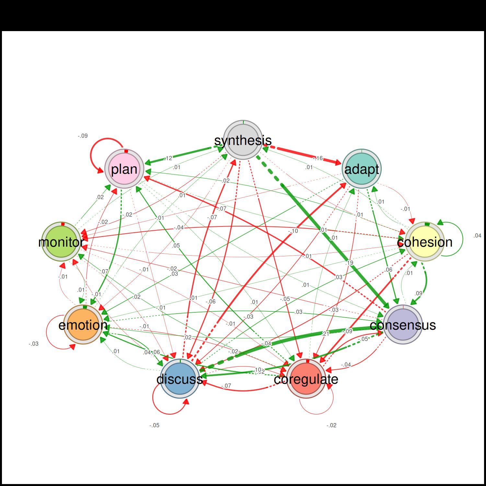

``` r


# Run a permutation test to determine statistical significance of differences
# between "Hi" and "Lo"
# The 'iter' argument is set to 1000, meaning 1000 permutations are performed
Permutation <- permutation_test(Hi, Lo, iter = 1000, measures = "Betweenness")

# Plot the significant differences identified in the permutation test
plot(Permutation, minimum = 0.01)
```

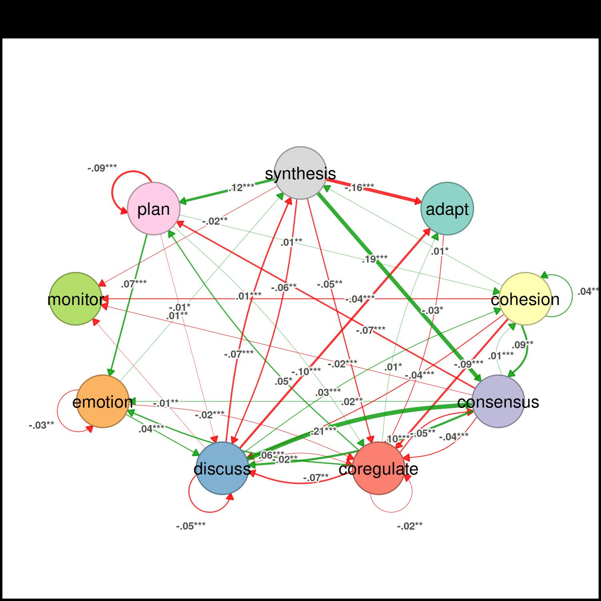

The tables of the test give the observed difference, its effect size,
and the p-value of every edge and of the betweenness of every state.

``` r

summary(Permutation)
#>         from    to diff_true effect_size p_value
#> 1      adapt adapt      0.00          NA   1.000
#> 2   cohesion adapt      0.01        1.99   0.061
#> 3  consensus adapt      0.00       -0.76   0.412
#> 4 coregulate adapt      0.01        2.00   0.048
#> 5    discuss adapt     -0.10      -11.48   0.001
#> 6    emotion adapt      0.00        0.91   0.460
#>  [ reached 'max' / getOption("max.print") -- omitted 75 rows ]
summary(Permutation, what = "centralities")
#>        state  centrality diff_true effect_size p_value
#> 1      adapt Betweenness        -3       -6.69   0.001
#> 2   cohesion Betweenness         0        0.00   1.000
#> 3  consensus Betweenness         5        7.01   0.001
#> 4 coregulate Betweenness        -3       -0.97   0.265
#> 5    discuss Betweenness         2        1.83   0.233
#> 6    emotion Betweenness         2       16.33   0.001
#>  [ reached 'max' / getOption("max.print") -- omitted 3 rows ]
```

#### Interpreting the Results of the Case-Dropping Bootstrap for Centrality Indices

A centrality ranking is only worth interpreting if it does not change
when part of the data is missing. The case-dropping bootstrap drops
increasing proportions of the sequences and correlates the centralities
of the remaining data with those of the full data; the CS-coefficient is
the largest proportion of dropped sequences at which the correlation is
at least 0.7 in at least 95% of the resamples.

``` r

# Results of the Case-Dropping Bootstrap for Centrality Indices
Centrality_stability <- estimate_centrality_stability(model, iter = 100)
plot(Centrality_stability)
```

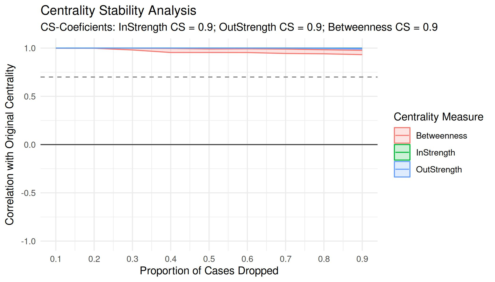

### More tutorials

**Package articles** · [sonsoles.me/tna](https://sonsoles.me/tna/)

- [Getting started with tna](https://sonsoles.me/tna/articles/tna.html)
  — build, plot, and summarize a transition network
- [Preparing data](https://sonsoles.me/tna/articles/prepare_data.html) —
  turn event logs into sequences with
  [`prepare_data()`](https://sonsoles.me/tna/reference/prepare_data.md)
- [A showcase of the main
  functions](https://sonsoles.me/tna/articles/complete_tutorial.html) —
  models, centralities, communities, and validation
- [Grouped sequence
  data](https://sonsoles.me/tna/articles/grouped_sequences.html) — build
  and compare networks of groups
- [Cliques and
  communities](https://sonsoles.me/tna/articles/communities_and_cliques.html)
  — find the densely connected states
- [Frequency-based TNA](https://sonsoles.me/tna/articles/ftna.html) —
  model transition counts instead of probabilities
- [Attention TNA](https://sonsoles.me/tna/articles/atna.html) —
  accumulate transitions across temporal distances
- [Validating a transition
  network](https://sonsoles.me/tna/articles/model-validation.html) —
  Markov order, bootstrap, case-dropping, reliability, and permutation
  tests
- [Function reference
  sheet](https://sonsoles.me/tna/articles/new-docs.html) — every
  function with its arguments and an example

**Tutorials** · [sonsoles.me](https://sonsoles.me/)

- [A comprehensive TNA
  tutorial](https://sonsoles.me/posts/tna-tutorial/) — an updated
  walkthrough of transition network analysis
- [Data preparation](https://sonsoles.me/posts/tna-data/) — from raw
  event data to sequences
- [Comparing models](https://sonsoles.me/posts/tna-compare/) — network
  comparison of TNA models
- [Clustering](https://sonsoles.me/posts/tna-clustering/) — discover and
  analyze clusters of sequences
- [Group analysis](https://sonsoles.me/posts/tna-group/) — permutation
  tests, bootstrapping, and clusters

**Book chapters** · *Advanced Learning Analytics Methods*

- [Mapping relational dynamics with
  TNA](https://lamethods.org/book2/chapters/ch15-tna/ch15-tna.html) — a
  primer and tutorial
- [Frequency transition network
  analysis](https://lamethods.org/book2/chapters/ch16-ftna/ch16-ftna.html)
  — a primer and tutorial on FTNA
- [Mining patterns and clusters with
  TNA](https://lamethods.org/book2/chapters/ch17-tna-clusters/ch17-tna-clusters.html)
  — a heterogeneity approach

**Dynalytics** · [dynasite.org](https://dynasite.org/)

- [Package sites](https://pak.dynasite.org/) — documentation of the R
  packages of the Dynalytics framework
- [Tools](https://dynasite.org/#/tools) — interactive web apps, jamovi,
  and Python
- [CarmNotes](https://dynasite.org/carmnotes) — single-file notebooks
  that run the analyses in the browser, even offline
- [Selected articles](https://dynasite.org/#/papers) — publications on
  the framework and its methods
