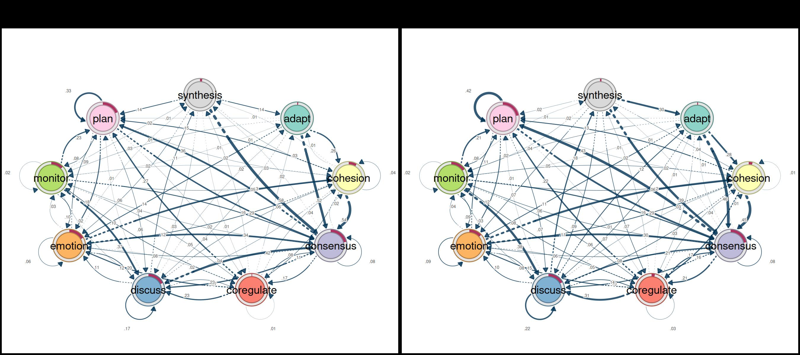
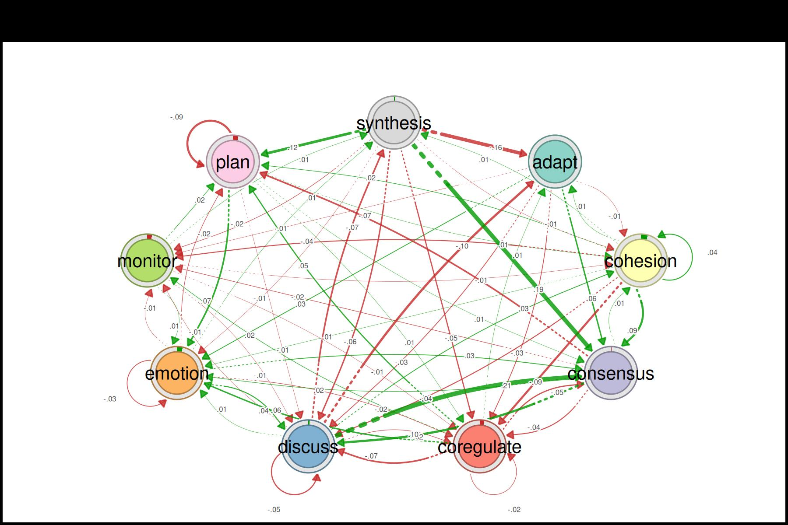
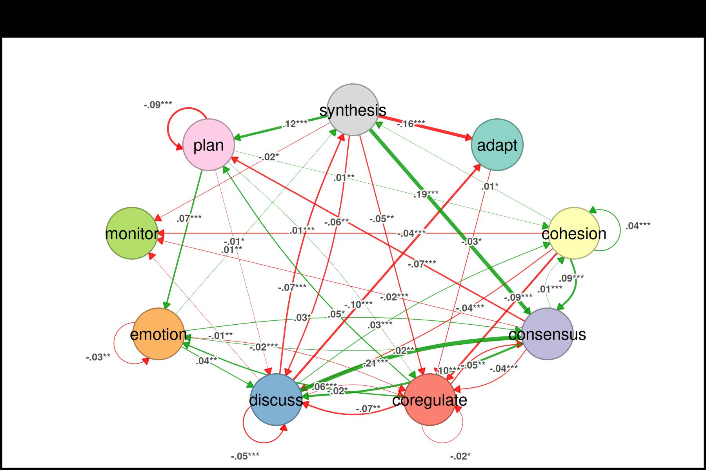
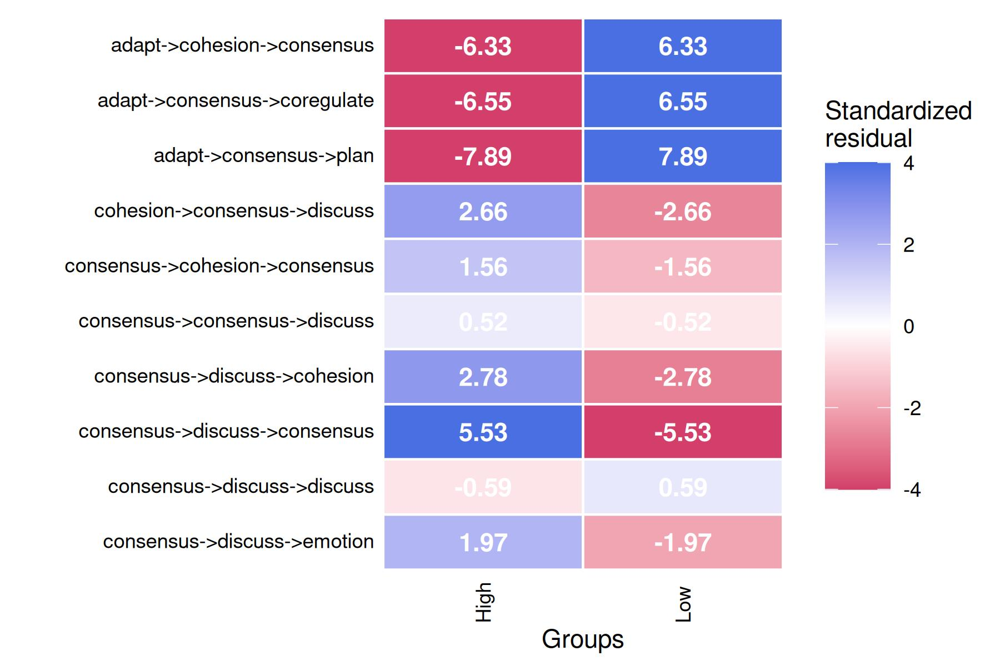
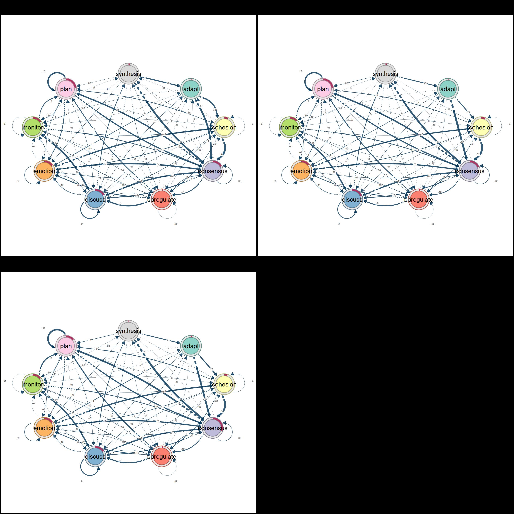
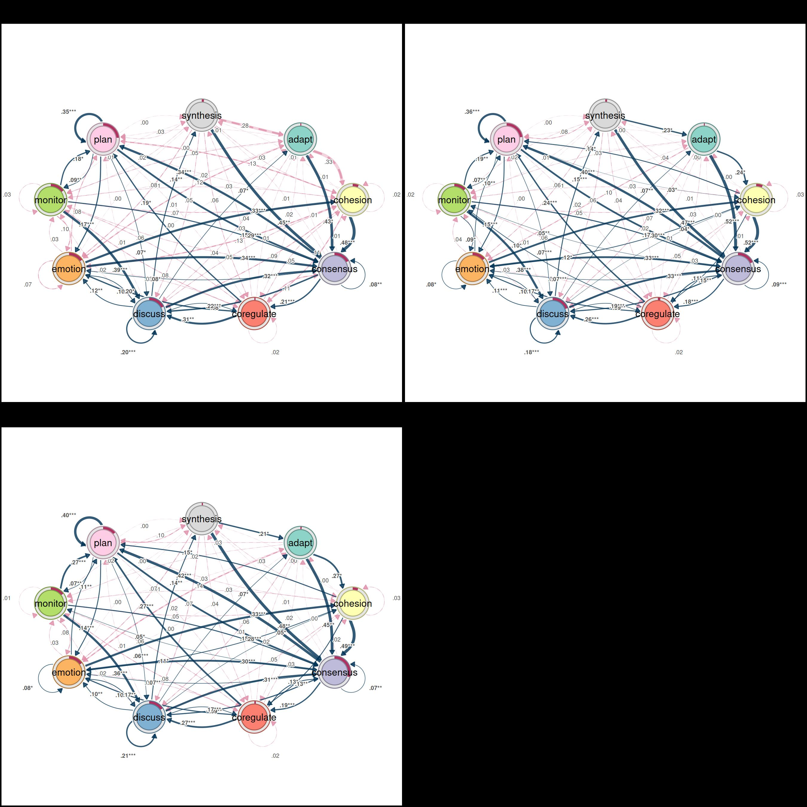
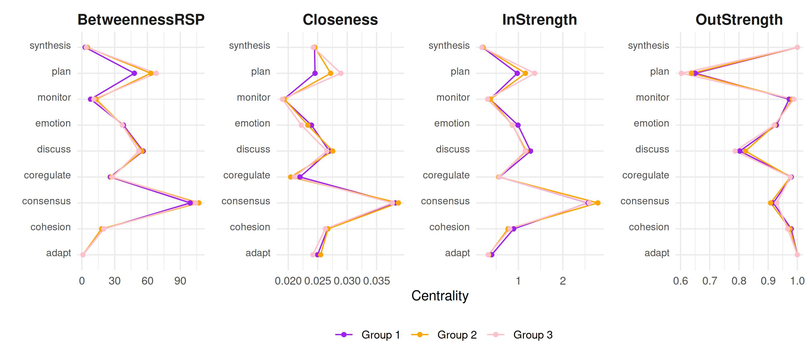
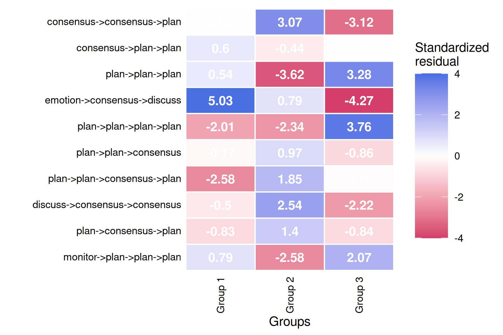

# Using grouped sequence data with tna

TNA supports the analysis of transition networks constructed from
grouped sequence data. Groups can be defined in several ways, but
mainly: using a pre-existing grouping variable in the data (e.g., a
demographic or experimental condition), or by clustering the sequences
themselves based on their similarity. This vignette demonstrates both
approaches using the `group_regulation_long` dataset.

First, we load the packages we will use for this example.

``` r

library("tna")
library("gt")
```

## Data preparation

We import the data in long format and prepare it for analysis. The
[`prepare_data()`](https://sonsoles.me/tna/reference/prepare_data.md)
function converts the long-format event log into wide-format sequences.
The unused columns in the dataset are stored in the metadata of
`prepared` and we can use them later on.

``` r

data("group_regulation_long", package = "tna")
prepared <- prepare_data(group_regulation_long,
                         actor = "Actor",
                         action = "Action",
                         time = "Time")
```

## Groups from a pre-existing variable

When the data contains a grouping variable, we can build separate TNA
models for each group directly. Here, the `"Achiever"` column in the
metadata splits the sequences into two groups (high vs. low achievers).

``` r

layout(t(1:2))
achievers <- group_tna(prepared, group = "Achiever")
plot(achievers)
#> Registered S3 method overwritten by 'cograph':
#>   method             from
#>   plot.tna_bootstrap tna
```



### Comparing groups

The
[`plot_compare()`](https://sonsoles.me/tna/reference/plot_compare.md)
function visualizes the difference network between the two groups. Green
edges and donut segments indicate that the first group (High achievers)
has higher values, while red indicates the opposite (Low achievers have
higher values).

``` r

plot_compare(achievers)
```



### Permutation test

The difference network shows how large the differences are, but not
whether they exceed what the random assignment of students to the two
groups would produce. A permutation test answers that question: it
reassigns the sequences to the groups many times and keeps only the
edges whose observed difference is unlikely under these reassignments.

``` r

permutation_test_results <- permutation_test(achievers)
plot(permutation_test_results)
```



### Subsequence comparison

We can also compare the frequency of subsequences across groups. Here we
look at subsequences of length 3 to 5, keeping only those that appear at
least 5 times, and apply FDR correction for multiple comparisons.

``` r

subsequence_comparison  <- compare_sequences(achievers,
                                                  sub = 3:5,
                                                  min_freq = 5,
                                                  adjust = "fdr")
plot(subsequence_comparison, cells = TRUE)
```



## Groups from sequence clustering

When no pre-existing grouping variable is available, we can cluster the
sequences based on their pairwise dissimilarity. The
[`cluster_sequences()`](https://sonsoles.me/tna/reference/cluster_data.md)
function computes the dissimilarity between every pair of sequences (the
Hamming distance by default) and partitions the sequences into `k`
clusters (with PAM by default).

``` r

clustering_results <- cluster_sequences(prepared, k = 3)
```

To choose an appropriate number of clusters, we can compare the
silhouette score for different values of *k*, which the printed
clustering reports. Higher silhouette values indicate better-separated
clusters.

``` r

lapply(2:4, \(k) cluster_sequences(prepared, k = k))
#> [[1]]
#> Clustering method: pam 
#> Number of clusters: 2 
#> Silhouette score: 0.1838904 
#> Cluster sizes:
#>    1    2 
#>  982 1018 
#> 
#> [[2]]
#> Clustering method: pam 
#> Number of clusters: 3 
#> Silhouette score: 0.1850873 
#> Cluster sizes:
#>   1   2   3 
#> 893 494 613 
#> 
#> [[3]]
#> Clustering method: pam 
#> Number of clusters: 4 
#> Silhouette score: 0.1327345 
#> Cluster sizes:
#>   1   2   3   4 
#> 707 506 379 408
```

Once we have chosen *k*, we build the grouped TNA model directly from
the clustering result, which carries the sequences and their cluster
assignments.

``` r

tna_model_clus <- group_tna(clustering_results)
```

``` r

layout(matrix(1:4, byrow = TRUE, ncol = 2))
plot(tna_model_clus)
```



### Summarizing the cluster-specific models

We can summarize the cluster-specific models to compare their overall
characteristics.

``` r

summary(tna_model_clus) |>
  gt() |>
  fmt_number(decimals = 2)
```

| metric                      | Group 1 | Group 2 | Group 3 |
|-----------------------------|---------|---------|---------|
| Node Count                  | 9.00    | 9.00    | 9.00    |
| Edge Count                  | 78.00   | 77.00   | 77.00   |
| Network Density             | 1.00    | 1.00    | 1.00    |
| Mean Distance               | 0.04    | 0.05    | 0.05    |
| Mean Out-Strength           | 1.00    | 1.00    | 1.00    |
| SD Out-Strength             | 0.00    | 0.00    | 0.00    |
| Mean In-Strength            | 1.00    | 1.00    | 1.00    |
| SD In-Strength              | 0.76    | 0.84    | 0.81    |
| Mean Out-Degree             | 8.67    | 8.56    | 8.56    |
| SD Out-Degree               | 0.71    | 0.73    | 0.73    |
| Centralization (Out-Degree) | 0.02    | 0.03    | 0.03    |
| Centralization (In-Degree)  | 0.02    | 0.03    | 0.03    |
| Reciprocity                 | 0.99    | 0.97    | 0.97    |

Printing the grouped model shows, for each cluster, the full transition
probability matrix and the initial probabilities, which show which
states are most common at the start of the sequences in each cluster.

``` r

print(tna_model_clus, digits = 2)
#> Group 1 :
#> State Labels : 
#> 
#>    adapt, cohesion, consensus, coregulate, discuss, emotion, monitor, plan, synthesis 
#> 
#> Transition Probability Matrix :
#> 
#>              adapt cohesion consensus coregulate discuss emotion monitor   plan
#> adapt      0.00000   0.3333     0.431      0.016   0.041   0.122   0.049 0.0081
#> cohesion   0.00524   0.0209     0.476      0.113   0.089   0.128   0.034 0.1283
#> consensus  0.00855   0.0093     0.082      0.205   0.221   0.076   0.042 0.3450
#> coregulate 0.01305   0.0470     0.115      0.021   0.311   0.198   0.076 0.1906
#> discuss    0.07395   0.0525     0.319      0.077   0.197   0.117   0.018 0.0086
#> emotion    0.00306   0.3323     0.345      0.031   0.100   0.072   0.032 0.0827
#> monitor    0.01401   0.0672     0.151      0.059   0.387   0.104   0.028 0.1849
#> plan       0.00091   0.0183     0.286      0.012   0.073   0.166   0.091 0.3498
#> synthesis  0.28000   0.0333     0.447      0.060   0.053   0.080   0.020 0.0267
#>            synthesis
#> adapt         0.0000
#> cohesion      0.0052
#> consensus     0.0109
#> coregulate    0.0287
#> discuss       0.1361
#> emotion       0.0031
#> monitor       0.0056
#> plan          0.0027
#> synthesis     0.0000
#> 
#> Initial Probabilities : 
#> 
#>      adapt   cohesion  consensus coregulate    discuss    emotion    monitor 
#>      0.010      0.060      0.170      0.015      0.177      0.157      0.151 
#>       plan  synthesis 
#>      0.236      0.024 
#> 
#> Group 2 :
#> State Labels : 
#> 
#>    adapt, cohesion, consensus, coregulate, discuss, emotion, monitor, plan, synthesis 
#> 
#> Transition Probability Matrix :
#> 
#>             adapt cohesion consensus coregulate discuss emotion monitor   plan
#> adapt      0.0000    0.241     0.524      0.028   0.066   0.104   0.033 0.0047
#> cohesion   0.0015    0.025     0.522      0.114   0.047   0.115   0.034 0.1391
#> consensus  0.0040    0.014     0.092      0.178   0.187   0.071   0.048 0.3989
#> coregulate 0.0131    0.033     0.149      0.024   0.260   0.165   0.100 0.2357
#> discuss    0.0719    0.040     0.328      0.086   0.178   0.107   0.029 0.0130
#> emotion    0.0000    0.320     0.326      0.034   0.101   0.077   0.041 0.0988
#> monitor    0.0139    0.054     0.170      0.059   0.385   0.094   0.017 0.1854
#> plan       0.0019    0.026     0.302      0.017   0.070   0.148   0.070 0.3627
#> synthesis  0.2273    0.038     0.469      0.042   0.063   0.063   0.014 0.0839
#>            synthesis
#> adapt         0.0000
#> cohesion      0.0015
#> consensus     0.0069
#> coregulate    0.0202
#> discuss       0.1481
#> emotion       0.0026
#> monitor       0.0225
#> plan          0.0019
#> synthesis     0.0000
#> 
#> Initial Probabilities : 
#> 
#>      adapt   cohesion  consensus coregulate    discuss    emotion    monitor 
#>      0.010      0.067      0.184      0.028      0.194      0.140      0.128 
#>       plan  synthesis 
#>      0.229      0.020 
#> 
#> Group 3 :
#> State Labels : 
#> 
#>    adapt, cohesion, consensus, coregulate, discuss, emotion, monitor, plan, synthesis 
#> 
#> Transition Probability Matrix :
#> 
#>             adapt cohesion consensus coregulate discuss emotion monitor  plan
#> adapt      0.0000    0.270      0.45      0.017   0.063   0.138  0.0230 0.034
#> cohesion   0.0031    0.033      0.49      0.129   0.055   0.108  0.0314 0.151
#> consensus  0.0035    0.019      0.07      0.189   0.171   0.073  0.0478 0.421
#> coregulate 0.0214    0.033      0.13      0.024   0.270   0.166  0.0763 0.268
#> discuss    0.0691    0.053      0.31      0.088   0.213   0.098  0.0171 0.012
#> emotion    0.0049    0.327      0.30      0.036   0.105   0.079  0.0333 0.112
#> monitor    0.0060    0.050      0.15      0.056   0.357   0.078  0.0120 0.273
#> plan       0.0000    0.027      0.28      0.019   0.064   0.137  0.0740 0.397
#> synthesis  0.2130    0.028      0.48      0.037   0.069   0.074  0.0046 0.097
#>            synthesis
#> adapt         0.0000
#> cohesion      0.0047
#> consensus     0.0065
#> coregulate    0.0120
#> discuss       0.1360
#> emotion       0.0029
#> monitor       0.0160
#> plan          0.0012
#> synthesis     0.0000
#> 
#> Initial Probabilities : 
#> 
#>      adapt   cohesion  consensus coregulate    discuss    emotion    monitor 
#>      0.015      0.055      0.302      0.018      0.158      0.153      0.147 
#>       plan  synthesis 
#>      0.139      0.013
```

### Pruning with bootstrap

Just like ordinary TNA models, we can retain only the statistically
robust edges. The bootstrap resamples the sequences of each cluster and
keeps the edges whose weight stays within the consistency range (by
default 75% to 125% of the observed weight) in at least 95% of the
resamples, so the plotted networks show only the transitions that do not
depend on a few sequences.

``` r

cluster_boot <- bootstrap(tna_model_clus)
```

``` r

layout(matrix(1:4, byrow = TRUE, ncol = 2))
plot(cluster_boot)
```



### Centrality measures

Centrality measures can be computed for each cluster to identify which
states play central roles in each group’s transition dynamics.

``` r

centrality_measures <- c(
  "BetweennessRSP",
  "Closeness",
  "InStrength",
  "OutStrength"
)
centralities_per_cluster <- centralities(
  tna_model_clus,
  measures = centrality_measures
)
plot(
  centralities_per_cluster, ncol = 4,
  colors = c("purple", "orange", "pink")
)
```



### Subsequence comparison across clusters

Finally, we can compare subsequence frequencies across the clusters,
just as we did for the pre-existing groups above.

``` r

subsequence_comparison  <- compare_sequences(tna_model_clus, sub = 3:5, min_freq = 5, adjust = "fdr")
plot(subsequence_comparison, cells = TRUE)
```



## More tutorials

**Package articles** · [sonsoles.me/tna](https://sonsoles.me/tna/)

- [Getting started with tna](https://sonsoles.me/tna/articles/tna.html)
  — build, plot, and summarize a transition network
- [Preparing data](https://sonsoles.me/tna/articles/prepare_data.html) —
  turn event logs into sequences with
  [`prepare_data()`](https://sonsoles.me/tna/reference/prepare_data.md)
- [A showcase of the main
  functions](https://sonsoles.me/tna/articles/complete_tutorial.html) —
  models, centralities, communities, and validation
- [Grouped sequence
  data](https://sonsoles.me/tna/articles/grouped_sequences.html) — build
  and compare networks of groups
- [Cliques and
  communities](https://sonsoles.me/tna/articles/communities_and_cliques.html)
  — find the densely connected states
- [Frequency-based TNA](https://sonsoles.me/tna/articles/ftna.html) —
  model transition counts instead of probabilities
- [Attention TNA](https://sonsoles.me/tna/articles/atna.html) —
  accumulate transitions across temporal distances
- [Validating a transition
  network](https://sonsoles.me/tna/articles/model-validation.html) —
  Markov order, bootstrap, case-dropping, reliability, and permutation
  tests
- [Function reference
  sheet](https://sonsoles.me/tna/articles/new-docs.html) — every
  function with its arguments and an example

**Tutorials** · [sonsoles.me](https://sonsoles.me/)

- [A comprehensive TNA
  tutorial](https://sonsoles.me/posts/tna-tutorial/) — an updated
  walkthrough of transition network analysis
- [Data preparation](https://sonsoles.me/posts/tna-data/) — from raw
  event data to sequences
- [Comparing models](https://sonsoles.me/posts/tna-compare/) — network
  comparison of TNA models
- [Clustering](https://sonsoles.me/posts/tna-clustering/) — discover and
  analyze clusters of sequences
- [Group analysis](https://sonsoles.me/posts/tna-group/) — permutation
  tests, bootstrapping, and clusters

**Book chapters** · *Advanced Learning Analytics Methods*

- [Mapping relational dynamics with
  TNA](https://lamethods.org/book2/chapters/ch15-tna/ch15-tna.html) — a
  primer and tutorial
- [Frequency transition network
  analysis](https://lamethods.org/book2/chapters/ch16-ftna/ch16-ftna.html)
  — a primer and tutorial on FTNA
- [Mining patterns and clusters with
  TNA](https://lamethods.org/book2/chapters/ch17-tna-clusters/ch17-tna-clusters.html)
  — a heterogeneity approach

**Dynalytics** · [dynasite.org](https://dynasite.org/)

- [Package sites](https://pak.dynasite.org/) — documentation of the R
  packages of the Dynalytics framework
- [Tools](https://dynasite.org/#/tools) — interactive web apps, jamovi,
  and Python
- [CarmNotes](https://dynasite.org/carmnotes) — single-file notebooks
  that run the analyses in the browser, even offline
- [Selected articles](https://dynasite.org/#/papers) — publications on
  the framework and its methods
