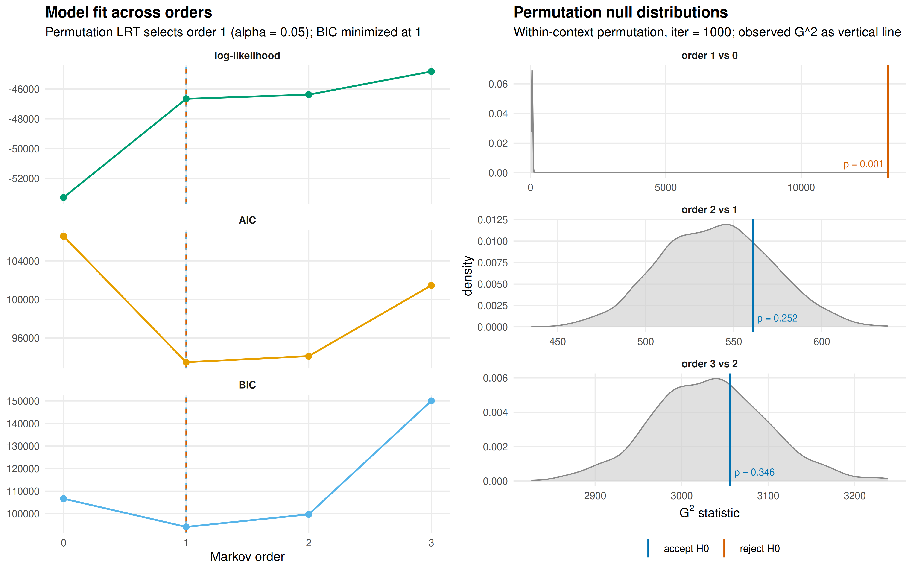
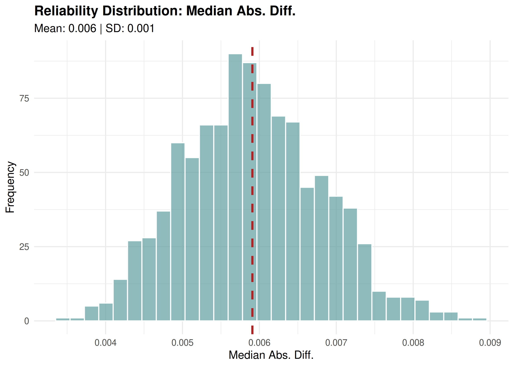
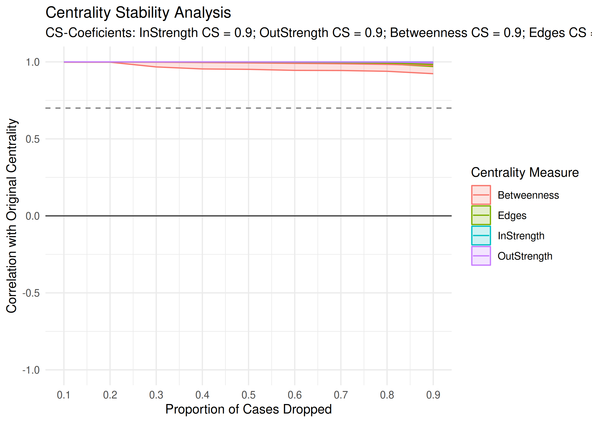
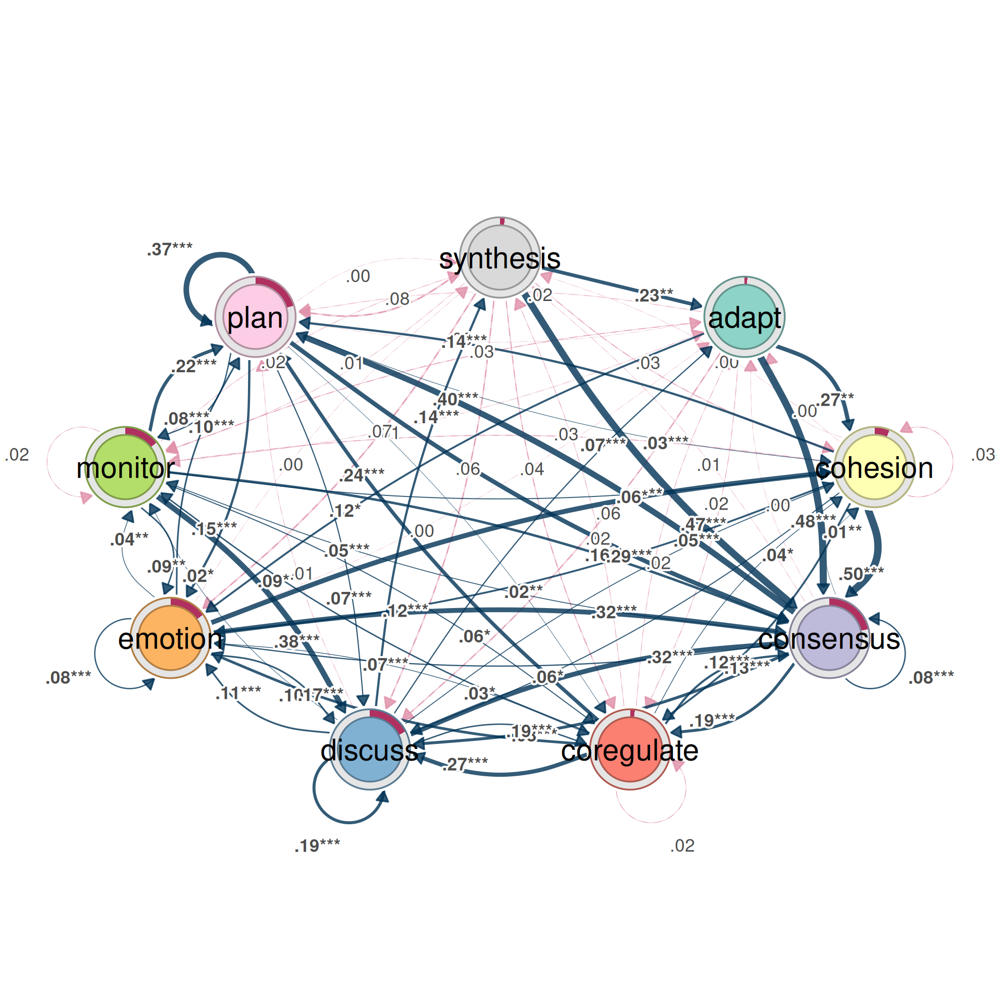
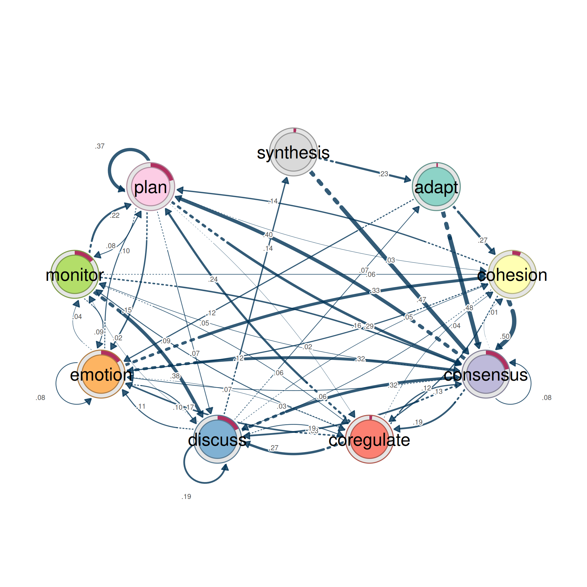
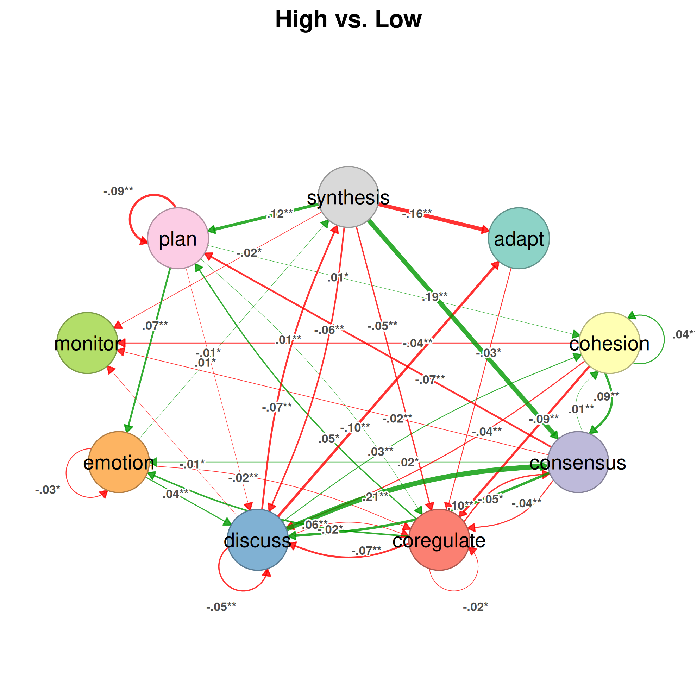
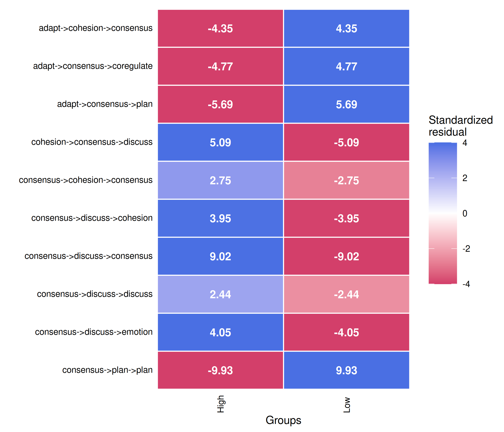

# Validating a transition network

A transition network estimated from empirical observations represents
the structure and dynamics of a process as observed in a particular data
set. Its structure and dynamics are, however, estimates, conditional on
the sample from which they were obtained and on the analytical
decisions, such as the coding scheme, that produced the data. The
patterns of an estimated network cannot, therefore, establish by
themselves whether they reflect systematic properties of the underlying
process or idiosyncrasies of the available data.

Dynalytics addresses this problem through the scientific contract: an
analytical conclusion is valid only when its supporting evidence matches
the inference it is meant to support (Saqr, López-Pernas, & Misiejuk,
2026). The contract ties the scope of a claim to the evidence required
to substantiate it. A claim about an individual transition requires
evidence about that transition; a claim that groups differ requires a
test that could have found no difference; and a claim about the temporal
dependence of the process requires a test of the assumptions of the
transition model. Descriptive observations, statistically supported
comparisons, and evidence of stability answer different inferential
questions, and one cannot stand in for another.

Within this framework, validation is a central part of transition
network analysis, essential to sound inference and analytical rigor
(Saqr et al., 2025; Tikka et al., 2025). The tna package provides a
procedure for each level of inference, and together they determine
whether an observed pattern warrants only a descriptive account,
supports a comparative conclusion, or is stable enough to support a
claim about the structure and dynamics of the underlying process:

| Level | Question | Procedure |
|----|----|----|
| Model choice | Does a one-step network suffice, or does the order of earlier events matter? | [`markov_order()`](https://sonsoles.me/tna/reference/markov_order.md) |
| Model assessment | Would the network recur in another sample, and how much of the data can be removed before it changes? | [`reliability()`](https://sonsoles.me/tna/reference/reliability.md), `estimate_cs(edges = TRUE)` |
| Edge | Is a single transition stable rather than an artefact of a few sequences? | [`bootstrap()`](https://sonsoles.me/tna/reference/bootstrap.md), [`prune()`](https://sonsoles.me/tna/reference/prune.md) |
| Comparison | Do groups differ beyond what random assignment produces? | [`permutation_test()`](https://sonsoles.me/tna/reference/permutation_test.md), [`compare_sequences()`](https://sonsoles.me/tna/reference/compare_sequences.md) |
| State | Is a state’s importance stable under changes in the sample, and does it differ between groups? | [`estimate_cs()`](https://sonsoles.me/tna/reference/estimate_centrality_stability.md), `permutation_test(measures = )` |

The sections below follow the order in which this evidence is assembled.
The model is specified first; the reliability of the network as a whole
is then established; and only then are individual transitions, group
differences, and state-level properties interpreted. Each level
constrains the next, since a network that replicates as a whole may
still contain individual transitions that do not. All resampling
procedures also accept an `actor` argument for data in which several
sequences belong to the same individual or group, which is addressed in
the final section.

## Data

The examples use `group_regulation_long`, a log of collaborative
regulation distributed with tna. Each of 2000 students contributes one
session, coded into nine regulation states. The students are organized
into 200 groups of ten, and the variable `Achiever` records whether a
group is high or low achieving.

``` r

prepared <- prepare_data(
  group_regulation_long,
  actor = "Actor",
  action = "Action",
  time = "Time"
)
model <- tna(prepared)
achievers <- group_tna(prepared, group = "Achiever")
```

`model` is the transition network of all students; `achievers` contains
one network for the high and one for the low achievers.

## 1. Model choice: is a first-order model adequate?

A first-order transition network models the next state as dependent on
the current state alone. If earlier states also condition the next one,
a first-order edge averages over distinct histories, and its
interpretation as a single mechanism is unwarranted. The order of the
process is therefore established before any edge is examined.
[`markov_order()`](https://sonsoles.me/tna/reference/markov_order.md)
tests each order against the order below it: for order *k*, it asks
whether the state *k* steps back still conditions the next state once
the *k − 1* most recent states are known. The statistic is the
likelihood ratio *G²*, and its p-value is obtained by permuting the next
states within each context, which preserves every count on which the
null hypothesis conditions. The order is increased for as long as the
test rejects.

``` r

set.seed(1)
markov <- markov_order(model, max_order = 3, iter = 1000)
markov
#> Markov order test (1000 permutations per order, 2000 sequences, 27533 states)
#> 
#>  order    loglik       aic       bic       g2   df p_value p_asymptotic
#>      0 -53280.55 106577.10 106642.88                                   
#>      1 -46660.94  93475.87  94109.05 13203.77   64   0.001        0.000
#>      2 -46377.27  94110.53  99685.82   561.07  532   0.252        0.185
#>      3 -44824.60 101463.19 150037.29  3056.22 3300   0.346        0.999
#>  significant
#>             
#>          yes
#>           no
#>           no
#> 
#> Selected order: 1 (sequential permutation tests at level 0.05)
#> Order with the lowest AIC: 1; lowest BIC: 1
```

The first-order dependence is unambiguous (*G²* = 13,203.8 on 64 degrees
of freedom, p = 0.001, the smallest value that 1000 permutations can
yield). The second order adds no explanatory power (p = 0.25), and the
sequential tests therefore select order **1**. AIC and BIC reach their
minima at orders 1 and 1, respectively, in agreement with the tests. A
first-order network is an adequate representation of these data.

The left panel displays the log-likelihood, AIC, and BIC of the
multi-order model across orders, marking the order selected by the tests
(dashed) and the order that minimizes BIC (dotted). The right panel
displays the permutation null distribution of each order together with
the observed *G²*, labelled with its p-value. The order-1 statistic lies
far beyond its null distribution, whereas the order-2 and order-3
statistics fall within theirs.

``` r

plot(markov)
```



Because the sequential procedure stops at the first non-rejection, it
cannot detect a dependence on the state two steps back that the current
state does not reveal.
[`markov_order()`](https://sonsoles.me/tna/reference/markov_order.md)
therefore issues a warning, and a note with its results, when a higher
order rejects or when AIC or BIC select a different order. It also warns
when `iter` is too small for any p-value to fall below `level` (fewer
than 20 permutations at the 0.05 level). Neither condition arises here.

A grouped model is tested group by group:

``` r

set.seed(2)
summary(markov_order(achievers, max_order = 2, iter = 1000))
#>  group order    loglik      aic      bic      g2  df p_value p_asymptotic
#>   High     0 -26084.40 52184.79 52245.00                                 
#>   High     1 -23001.71 46153.43 46717.93 6146.79  64   0.001        0.000
#>   High     2 -22751.38 46792.76 51647.47  491.66 503   0.616        0.633
#>    Low     0 -27055.17 54126.34 54186.61                                 
#>    Low     1 -23188.59 46525.19 47082.65 7714.71  64   0.001        0.000
#>    Low     2 -22949.47 47154.95 51885.86  471.20 480   0.642        0.604
#>  significant
#>             
#>          yes
#>           no
#>             
#>          yes
#>           no
```

Both groups require the first order and not the second, so the
group-specific first-order networks compared in later sections are
adequate models of their respective processes.

## 2. Model assessment: does the network recur in another sample?

With the model specified, the next question concerns the network as a
whole: whether its structure would recur in an independent sample.
[`reliability()`](https://sonsoles.me/tna/reference/reliability.md)
partitions the sequences at random into two halves of equal size,
estimates a network from each half, and compares the two. Because the
halves share no data, their agreement is evidence of replication rather
than of overlap. Repeated across many partitions, the procedure
indicates how far two independent samples of this size would diverge.
Each partition is evaluated on 22 metrics covering deviations between
the weights, correlations, dissimilarities, similarities, and agreement
in the rank and sign of the weights.

``` r

set.seed(6)
rel <- reliability(model, iter = 1000)
rel
#> Reliability summary
#> # A tibble: 4 × 8
#>   metric               mean       sd  median     min     max     q25     q75
#>   <chr>               <dbl>    <dbl>   <dbl>   <dbl>   <dbl>   <dbl>   <dbl>
#> 1 Mean Abs. Diff.   0.00957 0.00110  0.00952 0.00650 0.0152  0.00880 0.0103 
#> 2 Median Abs. Diff. 0.00591 0.000904 0.00588 0.00344 0.00886 0.00527 0.00650
#> 3 Pearson           0.993   0.00227  0.993   0.977   0.997   0.992   0.995  
#> 4 Bray-Curtis       0.0430  0.00495  0.0428  0.0293  0.0682  0.0396  0.0462
```

[`print()`](https://rdrr.io/r/base/print.html) reports four of these
metrics; [`summary()`](https://rdrr.io/r/base/summary.html) returns all
of them, so that a category can be selected:

``` r

reliability_metrics <- summary(rel)
subset(reliability_metrics, category == "Correlations")
#>        category   metric      mean          sd    median       min       max
#> 7  Correlations  Pearson 0.9930611 0.002265542 0.9934427 0.9767406 0.9974879
#> 8  Correlations Spearman 0.9873025 0.003141525 0.9876120 0.9749864 0.9940601
#> 9  Correlations  Kendall 0.9206808 0.009581896 0.9209245 0.8859703 0.9477751
#> 10 Correlations Distance 0.9910419 0.002322931 0.9912982 0.9703414 0.9959655
#>          q25       q75
#> 7  0.9919226 0.9946064
#> 8  0.9853884 0.9895726
#> 9  0.9144867 0.9275005
#> 10 0.9897751 0.9926568
```

The two halves are in close agreement. The median Pearson correlation
between their edge weights is 0.993, and in the least favourable of the
1,000 partitions it is 0.977. The weights of the two halves differ by
0.010 on average, on a scale on which the outgoing weights of each state
sum to one. The histogram displays the distribution of the median
absolute difference across partitions:

``` r

plot(rel)
```



A network estimated from half of these students reproduces the network
of the other half, which establishes the reliability of the model as a
whole. The argument `types` extends the comparison to several model
types in a single call, for example
`types = c("relative", "frequency")`.

## 3. Model assessment: how much data can be removed?

Split-half reliability compares two independent samples of equal size.
Case-dropping addresses a complementary question: how much of the data
can be removed before the network and its centrality rankings change.
[`estimate_cs()`](https://sonsoles.me/tna/reference/estimate_centrality_stability.md)
removes increasing proportions of the sequences (10% to 90%),
re-estimates the network from the remainder, and correlates the result
with the original. The CS-coefficient is the largest proportion that can
be removed while the correlation remains above 0.7 in 95% of the draws.
A CS-coefficient of at least 0.5 supports interpretation; a value below
0.25 does not. With `edges = TRUE`, the edge weights are assessed
alongside the centralities, restricted to the edges present in the
network: a subsample cannot contain a transition absent from the full
data, so the empty cells would agree in every draw and inflate the
apparent stability of any network.

``` r

set.seed(5)
stability <- estimate_cs(
  model,
  measures = c("InStrength", "OutStrength", "Betweenness"),
  iter = 1000,
  edges = TRUE
)
cs <- summary(stability)
cs
#>       measure cs_coefficient
#> 1  InStrength            0.9
#> 2 OutStrength            0.9
#> 3 Betweenness            0.9
#> 4       Edges            0.9
```

Every CS-coefficient reaches the largest proportion tested: with 90% of
the sequences removed, the edge weights and the three centrality
measures still correlate above 0.7 with the full network in 95% of the
draws. With 2,000 sequences, both the edge weights and the centrality
rankings are stable enough to be reported. The plot displays the mean
correlation at each proportion together with the central 95% of the
draws:

``` r

plot(stability)
```



## 4. Edges: which transitions are reliable?

A network that replicates as a whole may still contain individual
transitions that do not. Each edge weight is an estimate, and another
sample would yield a somewhat different transition probability.
[`bootstrap()`](https://sonsoles.me/tna/reference/bootstrap.md)
resamples the sequences with replacement, re-estimates the network in
each sample, and records every weight, reporting for each edge a 95%
percentile confidence interval and a p-value.

The p-value depends on `method`. Under the default
`method = "stability"`, an edge is considered reliable when its weight
remains within ±25% of the observed value
(`consistency_range = c(0.75, 1.25)`) in at least 95% of the samples;
the p-value is the proportion of samples that fall outside this range.

``` r

set.seed(3)
boot <- bootstrap(model, iter = 1000)
edges <- summary(boot)
subset(edges, !sig)
#>          from         to       weight    p_value   sig     cr_lower    cr_upper
#> 2    cohesion      adapt 0.0029498525 0.49650350 FALSE 0.0022123894 0.003687316
#> 3   consensus      adapt 0.0047400853 0.17482517 FALSE 0.0035550640 0.005925107
#> 4  coregulate      adapt 0.0162436548 0.17182817 FALSE 0.0121827411 0.020304569
#> 6     emotion      adapt 0.0024673951 0.54645355 FALSE 0.0018505464 0.003084244
#> 7     monitor      adapt 0.0111653873 0.31668332 FALSE 0.0083740405 0.013956734
#> 8        plan      adapt 0.0009745006 0.55444555 FALSE 0.0007308754 0.001218126
#> 11   cohesion   cohesion 0.0271386431 0.11688312 FALSE 0.0203539823 0.033923304
#> 18  synthesis   cohesion 0.0337423313 0.23976024 FALSE 0.0253067485 0.042177914
#> 28      adapt coregulate 0.0216110020 0.42657343 FALSE 0.0162082515 0.027013752
#> 31 coregulate coregulate 0.0233502538 0.09690310 FALSE 0.0175126904 0.029187817
#> 36  synthesis coregulate 0.0444785276 0.19380619 FALSE 0.0333588957 0.055598160
#> 37      adapt    discuss 0.0589390963 0.15984016 FALSE 0.0442043222 0.073673870
#> 45  synthesis    discuss 0.0628834356 0.11188811 FALSE 0.0471625767 0.078604294
#> 54  synthesis    emotion 0.0705521472 0.09990010 FALSE 0.0529141104 0.088190184
#> 55      adapt    monitor 0.0333988212 0.29170829 FALSE 0.0250491159 0.041748527
#> 56   cohesion    monitor 0.0330383481 0.06293706 FALSE 0.0247787611 0.041297935
#> 61    monitor    monitor 0.0181437544 0.17682318 FALSE 0.0136078158 0.022679693
#> 63  synthesis    monitor 0.0122699387 0.46553447 FALSE 0.0092024540 0.015337423
#> 64      adapt       plan 0.0157170923 0.46353646 FALSE 0.0117878193 0.019646365
#> 68    discuss       plan 0.0116426221 0.08191808 FALSE 0.0087319666 0.014553278
#> 72  synthesis       plan 0.0751533742 0.06993007 FALSE 0.0563650307 0.093941718
#> 74   cohesion  synthesis 0.0035398230 0.55344655 FALSE 0.0026548673 0.004424779
#> 75  consensus  synthesis 0.0075841365 0.07492507 FALSE 0.0056881024 0.009480171
#> 76 coregulate  synthesis 0.0187817259 0.12587413 FALSE 0.0140862944 0.023477157
#> 78    emotion  synthesis 0.0028198802 0.48351648 FALSE 0.0021149101 0.003524850
#> 79    monitor  synthesis 0.0160502442 0.24575425 FALSE 0.0120376832 0.020062805
#> 80       plan  synthesis 0.0017865844 0.40559441 FALSE 0.0013399383 0.002233230
#>        ci_lower    ci_upper
#> 2  0.0005972741 0.005592700
#> 3  0.0031044576 0.006482952
#> 4  0.0109609533 0.022545188
#> 6  0.0010171118 0.004456825
#> 7  0.0058426221 0.017045648
#> 8  0.0003176194 0.001782856
#> 11 0.0187891718 0.035477977
#> 18 0.0213064352 0.048747348
#> 28 0.0098785280 0.034284686
#> 31 0.0164291290 0.030402583
#> 36 0.0288450000 0.062312280
#> 37 0.0394446845 0.079918133
#> 45 0.0436014914 0.083202572
#> 54 0.0508714771 0.091203850
#> 55 0.0183444537 0.048487302
#> 56 0.0242310738 0.041646233
#> 61 0.0121400879 0.025094108
#> 63 0.0046798233 0.021053058
#> 64 0.0059517928 0.027349133
#> 68 0.0086612225 0.015058931
#> 72 0.0540947826 0.094553431
#> 74 0.0011553017 0.006544016
#> 75 0.0055585136 0.009702808
#> 76 0.0127863461 0.024659315
#> 78 0.0010604173 0.004977292
#> 79 0.0094583462 0.023338048
#> 80 0.0008170937 0.002884339
```

Of the 78 edges, 51 are reliable and the 27 listed above are not. The
unreliable edges are the weak ones: their median weight is 0.016,
compared with 0.119 for the reliable edges. A weak edge fails because a
small transition probability cannot be estimated to within 25%, not
necessarily because the transition is absent. The confidence intervals
confirm this: the interval of every one of these 27 edges excludes zero
(`ci_lower` is above 0), and the interval of every one extends beyond
the ±25% range (`cr_lower`, `cr_upper`).

In the plot, every edge is drawn: the reliable edges as solid lines
marked with stars, the remainder as grey dashed lines.

``` r

plot(boot)
#> Registered S3 method overwritten by 'cograph':
#>   method             from
#>   plot.tna_bootstrap tna
```



The alternative method addresses a different question. Under
`method = "threshold"`, an edge is considered reliable when its weight
remains above `threshold` (by default the 10th percentile of the edge
weights) in at least 95% of the samples:

``` r

set.seed(4)
boot_threshold <- bootstrap(model, iter = 1000, method = "threshold")
nrow(subset(summary(boot_threshold), sig))
#> [1] 71
```

71 edges pass the threshold test, 20 more than pass the stability test.
The threshold test establishes whether a transition reliably exists; the
stability test establishes whether its weight is estimated precisely.
The stability test is appropriate when the weights themselves are
interpreted, and the threshold test when only the presence of a
transition is at issue.

### Pruning the network to the reliable edges

[`prune()`](https://sonsoles.me/tna/reference/prune.md) removes the
edges that the bootstrap does not support. Supplying the bootstrap
result reuses it, so that the pruned network retains exactly the
reliable edges identified above:

``` r

pruned <- prune(model, boot = boot)
plot(pruned)
```



The pruned network has 51 edges, against 78 in the full network.
[`pruning_details()`](https://sonsoles.me/tna/reference/pruning_details.md)
lists the removed edges,
[`deprune()`](https://sonsoles.me/tna/reference/deprune.md) restores
them, and [`reprune()`](https://sonsoles.me/tna/reference/reprune.md)
removes them again, so that either version can be displayed without
repeating the bootstrap.

[`prune()`](https://sonsoles.me/tna/reference/prune.md) also offers
three methods that involve no resampling: a fixed weight `threshold`,
the `lowest` proportion of weights, and the disparity filter, which
retains the edges that carry a disproportionate share of a state’s
outgoing weight:

``` r

disparity <- prune(model, method = "disparity", level = 0.5)
subset(summary(disparity), metric == "Edge Count")
#> # A tibble: 1 × 2
#>   metric     value
#>   <chr>      <dbl>
#> 1 Edge Count    38
```

The disparity filter retains 38 of the 78 edges. These methods reduce
the density of a network for display, but they carry no information
about sampling error; only bootstrap pruning removes the edges that
another sample might fail to reproduce.

## 5. Comparison: do the groups differ?

A claim that two groups differ requires a test that could have found no
difference.
[`permutation_test()`](https://sonsoles.me/tna/reference/permutation_test.md)
asks whether high and low achievers differ by more than random
reassignment of the sequences to the two groups would produce. For every
edge, it compares the observed difference in weight with the
distribution of differences under permuted group labels; with
`measures`, it does the same for centrality measures. The effect size is
the observed difference divided by the standard deviation of the
permuted differences.

The test is conducted on every edge simultaneously, here 81 tests. Under
the default `adjust = "none"`, about 4 of the 81 edges would reach
significance at the 0.05 level even if the groups did not differ. An
adjustment for multiple comparisons is therefore required; `"fdr"`
controls the false discovery rate:

``` r

set.seed(7)
permutation <- permutation_test(
  achievers,
  iter = 1000,
  adjust = "fdr",
  measures = c("InStrength", "Betweenness")
)
edge_differences <- summary(permutation)
subset(edge_differences, p_value < 0.05)
#>            pair       from         to diff_true effect_size     p_value
#> 5  High vs. Low    discuss      adapt     -0.10      -11.11 0.003371628
#> 9  High vs. Low  synthesis      adapt     -0.16       -4.66 0.003371628
#> 11 High vs. Low   cohesion   cohesion      0.04        4.53 0.003371628
#> 12 High vs. Low  consensus   cohesion      0.01        3.48 0.003371628
#> 14 High vs. Low    discuss   cohesion      0.03        4.37 0.003371628
#> 17 High vs. Low       plan   cohesion      0.01        2.96 0.010441172
#> 20 High vs. Low   cohesion  consensus      0.09        3.58 0.005779934
#> 22 High vs. Low coregulate  consensus     -0.05       -3.00 0.010441172
#> 23 High vs. Low    discuss  consensus      0.21       14.21 0.003371628
#> 27 High vs. Low  synthesis  consensus      0.19        4.83 0.003371628
#> 28 High vs. Low      adapt coregulate     -0.03       -2.39 0.034071192
#> 29 High vs. Low   cohesion coregulate     -0.09       -5.26 0.003371628
#> 30 High vs. Low  consensus coregulate     -0.04       -3.68 0.003371628
#> 31 High vs. Low coregulate coregulate     -0.02       -2.57 0.041496965
#> 32 High vs. Low    discuss coregulate     -0.02       -2.66 0.017164654
#> 33 High vs. Low    emotion coregulate     -0.02       -3.41 0.003371628
#> 35 High vs. Low       plan coregulate      0.01        3.69 0.003371628
#> 36 High vs. Low  synthesis coregulate     -0.05       -3.20 0.005779934
#> 38 High vs. Low   cohesion    discuss     -0.04       -3.83 0.003371628
#> 39 High vs. Low  consensus    discuss      0.10        9.08 0.003371628
#> 40 High vs. Low coregulate    discuss     -0.07       -3.49 0.003371628
#> 41 High vs. Low    discuss    discuss     -0.05       -4.13 0.003371628
#> 42 High vs. Low    emotion    discuss      0.04        3.68 0.003371628
#> 44 High vs. Low       plan    discuss     -0.01       -2.23 0.046528472
#> 45 High vs. Low  synthesis    discuss     -0.06       -3.03 0.005779934
#> 48 High vs. Low  consensus    emotion      0.02        2.79 0.020229770
#> 49 High vs. Low coregulate    emotion      0.06        3.18 0.005779934
#> 51 High vs. Low    emotion    emotion     -0.03       -2.91 0.015172328
#> 53 High vs. Low       plan    emotion      0.07        7.22 0.003371628
#> 56 High vs. Low   cohesion    monitor     -0.04       -4.18 0.003371628
#> 57 High vs. Low  consensus    monitor     -0.02       -4.60 0.003371628
#> 59 High vs. Low    discuss    monitor     -0.01       -2.51 0.020229770
#> 63 High vs. Low  synthesis    monitor     -0.02       -2.55 0.010441172
#> 66 High vs. Low  consensus       plan     -0.07       -5.59 0.003371628
#> 67 High vs. Low coregulate       plan      0.05        2.52 0.032805033
#> 71 High vs. Low       plan       plan     -0.09       -6.72 0.003371628
#> 72 High vs. Low  synthesis       plan      0.12        5.84 0.003371628
#> 77 High vs. Low    discuss  synthesis     -0.07       -6.31 0.003371628
#> 78 High vs. Low    emotion  synthesis      0.01        2.66 0.019039784
#> 80 High vs. Low       plan  synthesis      0.00        2.92 0.003371628
```

After adjustment, 40 of the 81 transitions differ between high and low
achievers. The differences are substantial: 27 of them have an absolute
effect size above 3, meaning that the observed difference lies more than
three standard deviations from the differences produced by random
grouping.

The plot displays the differences that remain significant after
adjustment, positive where high achievers have the larger weight:

``` r

plot(permutation)
```



The centrality measures are tested in the same procedure, and
[`summary()`](https://rdrr.io/r/base/summary.html) returns them with
`what = "centralities"`:

``` r

centrality_differences <- summary(permutation, what = "centralities")
subset(centrality_differences, p_value < 0.05)
#>            pair      state  centrality diff_true effect_size     p_value
#> 1  High vs. Low      adapt  InStrength     -0.24       -6.50 0.002568860
#> 3  High vs. Low  consensus  InStrength      0.54        7.70 0.002568860
#> 4  High vs. Low coregulate  InStrength     -0.25       -7.56 0.002568860
#> 6  High vs. Low    emotion  InStrength      0.19        3.98 0.002568860
#> 7  High vs. Low    monitor  InStrength     -0.09       -3.36 0.005994006
#> 8  High vs. Low       plan  InStrength      0.12        2.58 0.027790391
#> 9  High vs. Low  synthesis  InStrength     -0.05       -3.21 0.004495504
#> 10 High vs. Low      adapt Betweenness     -3.00       -6.19 0.002568860
#> 12 High vs. Low  consensus Betweenness      5.00        6.51 0.002568860
#> 15 High vs. Low    emotion Betweenness      2.00       13.85 0.002568860
#> 18 High vs. Low  synthesis Betweenness      7.00       18.25 0.007192807
```

7 of the nine states differ in in-strength, that is, in the share of the
regulation process that flows into them, and 4 in betweenness.

### Differences in edge betweenness

The edge betweenness of a transition counts the shortest paths between
other states that pass through it, and thereby identifies the
transitions on which the process depends to move between states.
[`betweenness_network()`](https://sonsoles.me/tna/reference/betweenness_network.md)
replaces each weight with its edge betweenness, and the permutation test
recomputes edge betweenness in every permutation:

``` r

set.seed(8)
betweenness <- permutation_test(
  betweenness_network(achievers),
  iter = 1000,
  adjust = "fdr"
)
bridge_differences <- summary(betweenness)
subset(bridge_differences, p_value < 0.05)
#>            pair       from         to diff_true effect_size    p_value
#> 5  High vs. Low    discuss      adapt        -9      -23.47 0.01348651
#> 9  High vs. Low  synthesis      adapt         6        9.82 0.04045954
#> 10 High vs. Low      adapt   cohesion        -2      -25.81 0.01348651
#> 15 High vs. Low    emotion   cohesion         2       14.91 0.01348651
#> 20 High vs. Low   cohesion  consensus         4       13.96 0.01348651
#> 29 High vs. Low   cohesion coregulate        -4      -13.96 0.01348651
#> 40 High vs. Low coregulate    discuss        -2       -5.21 0.01348651
#> 77 High vs. Low    discuss  synthesis         7       18.19 0.04045954
```

After adjustment, 8 transitions carry a different number of shortest
paths in the two groups: the groups route their regulation through
partly different bridges.

### Differences in sequence patterns

Patterns of two states are the transitions already compared by
[`permutation_test()`](https://sonsoles.me/tna/reference/permutation_test.md).
[`compare_sequences()`](https://sonsoles.me/tna/reference/compare_sequences.md)
extends the comparison to longer patterns: it counts the subsequences of
consecutive states of the specified lengths in each group and tests the
differences in their proportions by permutation. Here it compares
patterns of three to five states. Its default adjustment, Bonferroni, is
conservative when the number of patterns is large:

``` r

set.seed(9)
patterns_bonferroni <- compare_sequences(achievers, sub = 3:5, iter = 1000)
nrow(subset(patterns_bonferroni, p_value < 0.05))
#> [1] 0
```

No pattern reaches significance. Bonferroni multiplies each p-value by
the number of patterns of the same length, which here runs into the
hundreds, whereas 1,000 permutations cannot yield a p-value below
1/1001; the smallest adjusted p-value is 0.573. Under the false
discovery rate:

``` r

set.seed(9)
patterns <- compare_sequences(
  achievers,
  sub = 3:5,
  iter = 1000,
  adjust = "fdr"
)
nrow(subset(patterns, p_value < 0.05))
#> [1] 62
```

62 of the 842 patterns of three to five states differ between the
groups. The rows are ordered by p-value, and the plot displays the
standardized residuals of the counts of the first ten patterns in each
group:

``` r

plot(patterns)
```



When many patterns are compared, the false discovery rate should be
used, or `iter` raised until the Bonferroni-adjusted p-values can fall
below the significance level.

## 6. Sequences nested in actors

All resampling procedures assume that the sequences are independent.
When several sequences belong to the same unit, such as the sessions of
one student or the students of one group, they tend to resemble one
another, and treating them as independent yields confidence intervals
that are too narrow and p-values that are too small. The argument
`actor` identifies the unit, either as a column of the data from which
the model was estimated or as a vector with one value per sequence. The
bootstrap then resamples whole actors (a cluster bootstrap), the
permutation test reassigns whole actors between groups, case-dropping
removes whole actors, and split-half reliability assigns all sequences
of an actor to the same half.

In these data, achievement is a property of the group: all ten students
of a group are either high or low achievers. Because the unit assigned
to the condition is the group, the permutation test should reassign
whole groups:

``` r

set.seed(10)
permutation_groups <- permutation_test(
  achievers,
  iter = 1000,
  adjust = "fdr",
  actor = "Group"
)
nrow(subset(summary(permutation_groups), p_value < 0.05))
#> [1] 39
```

``` r

set.seed(11)
boot_groups <- bootstrap(model, iter = 1000, actor = "Group")
with(summary(boot), median(ci_upper - ci_lower))
#> [1] 0.02140187
with(summary(boot_groups), median(ci_upper - ci_lower))
#> [1] 0.02231945
```

When whole groups are reassigned, the permutation test identifies 39
differing transitions, compared with 40 when students are reassigned
individually, and the confidence intervals of the cluster bootstrap are
only 4% wider than those of the ordinary bootstrap (median width). In
these data the students of a group are no more alike than students of
different groups, so the nesting has little effect and the conclusions
of the preceding sections stand. This is an empirical finding rather
than an assumption. When the sequences of a unit do resemble one
another, as the sessions of a single student commonly do, specifying
`actor` distinguishes a valid test from an overconfident one, and it
should be specified whenever the data are nested.

A related restriction concerns scaled weights. A grouped model estimated
with `scaling` (for example `group_model(..., scaling = "minmax")`) is
not resampled, nor are the networks it contains: scaling across groups
depends on every group, which a resample of a single group cannot
reproduce. Groups should be estimated without `scaling` for validation.

## Matching claims to evidence

The question determines the level, and the level determines the
procedure. Each statement in a report should be assigned to its level
and matched to the procedure that supports it; a statement and a
procedure at different levels indicate an error in one of them.

- **Model choice.**
  [`markov_order()`](https://sonsoles.me/tna/reference/markov_order.md)
  precedes every other analysis. If it selects an order above one, a
  first-order network averages over distinct histories, and subsequent
  results describe an incomplete model.
- **Model assessment.**
  [`reliability()`](https://sonsoles.me/tna/reference/reliability.md)
  establishes that the network would recur in an independent sample, and
  `estimate_cs(edges = TRUE)` how much of the data can be lost before
  the edge weights change; a CS-coefficient of at least 0.5 should be
  reported.
- **Edge.**
  [`bootstrap()`](https://sonsoles.me/tna/reference/bootstrap.md) is
  required before a single transition is interpreted, and
  `prune(boot = )` restricts a figure to the reliable transitions.
  `method = "stability"` is appropriate when the weights are
  interpreted, and `method = "threshold"` when only the presence of a
  transition is.
- **Comparison.**
  [`permutation_test()`](https://sonsoles.me/tna/reference/permutation_test.md)
  with `adjust = "fdr"` supports a claim that groups differ;
  [`betweenness_network()`](https://sonsoles.me/tna/reference/betweenness_network.md)
  precedes it when the question concerns the transitions that act as
  bridges, and
  [`compare_sequences()`](https://sonsoles.me/tna/reference/compare_sequences.md)
  with `sub = 3:5` when it concerns patterns longer than a single
  transition.
- **State.**
  [`estimate_cs()`](https://sonsoles.me/tna/reference/estimate_centrality_stability.md)
  is required before centrality rankings are interpreted, and
  `permutation_test(measures = )` before a state’s importance is claimed
  to differ between groups.
- **Nesting.** `actor` should be specified in every procedure whenever
  several sequences belong to the same individual or group.

## References

Saqr, M., López-Pernas, S., & Misiejuk, K. (2026). Dynalytics: The birth
of a framework for rigorous analytics of dynamical systems. In
*Innovations in Analytics of Learning Dynamics* (Communications in
Computer and Information Science, pp. 3–17). Springer.
<https://doi.org/10.1007/978-3-032-34157-0_1>

Saqr, M., López-Pernas, S., Törmänen, T., Kaliisa, R., Misiejuk, K., &
Tikka, S. (2025). Transition network analysis: A novel framework for
modeling, visualizing, and identifying the temporal patterns of learners
and learning processes. In *Proceedings of the 15th International
Learning Analytics and Knowledge Conference (LAK ’25)* (pp. 351–361).
ACM. <https://doi.org/10.1145/3706468.3706513>

Tikka, S., López-Pernas, S., & Saqr, M. (2025). tna: An R package for
transition network analysis. *Applied Psychological Measurement*, *49*,
326–328. <https://doi.org/10.1177/01466216251348840>

## Further reading

Ahmed, H., Siddika, A., López-Pernas, S., Tukiainen, M., & Saqr, M.
(2026). The longitudinal dynamics of GenAI roles: An idiographic
approach. In *Innovations in Analytics of Learning Dynamics*
(Communications in Computer and Information Science, pp. 138–150).
Springer. <https://doi.org/10.1007/978-3-032-34157-0_11>

López-Pernas, S., Misiejuk, K., Kaliisa, R., & Saqr, M. (2025).
Capturing the process of students’ AI interactions when creating and
learning complex network structures. *IEEE Transactions on Learning
Technologies*, *18*, 556–568. <https://doi.org/10.1109/tlt.2025.3568599>

López-Pernas, S., Misiejuk, K., Oliveira, E., & Saqr, M. (2025). The
dynamics of the self-regulation process in student-AI interactions: The
case of problem-solving in programming education. In *Proceedings of the
25th Koli Calling International Conference on Computing Education
Research* (pp. 1–12). ACM. <https://doi.org/10.1145/3769994.3770043>

López-Pernas, S., Misiejuk, K., Tikka, S., & Saqr, M. (2026). Role
dynamics in student–AI collaboration: A heterogeneous transition network
analysis approach. In *Innovations in Analytics of Learning Dynamics*
(Communications in Computer and Information Science, pp. 18–33).
Springer. <https://doi.org/10.1007/978-3-032-34157-0_2>

Misiejuk, K., Kaliisa, R., López-Pernas, S., & Saqr, M. (2025).
Expanding the quantitative ethnography toolkit with transition network
analysis: Exploring methodological synergies and boundaries. In
*Advances in Quantitative Ethnography. ICQE 2025* (Communications in
Computer and Information Science, Vol. 2677, pp. 147–161). Springer.
<https://doi.org/10.1007/978-3-032-12229-2_10>

Misiejuk, K., Oliveira, E., Song, Y., López-Pernas, S., & Saqr, M.
(2026). Modeling observation lens in co-occurrence network analysis:
Four window approaches and implementations. In *Innovations in Analytics
of Learning Dynamics* (Communications in Computer and Information
Science, pp. 34–50). Springer.
<https://doi.org/10.1007/978-3-032-34157-0_3>

Saqr, M., López-Pernas, S., & Tikka, S. (2026). Modeling stability and
change from a complex systems perspective. In *Innovations in Analytics
of Learning Dynamics* (Communications in Computer and Information
Science, pp. 51–61). Springer.
<https://doi.org/10.1007/978-3-032-34157-0_4>

Törmänen, T., Saqr, M., López-Pernas, S., Mänty, K., Suoraniemi, J.,
Heikkala, N., & Järvenoja, H. (2025). Emotional dynamics and regulation
in collaborative learning. *Learning and Instruction*, *100*, 102188.
<https://doi.org/10.1016/j.learninstruc.2025.102188>

## More tutorials

**Package articles** · [sonsoles.me/tna](https://sonsoles.me/tna/)

- [Getting started with tna](https://sonsoles.me/tna/articles/tna.html)
  — build, plot, and summarize a transition network
- [Preparing data](https://sonsoles.me/tna/articles/prepare_data.html) —
  turn event logs into sequences with
  [`prepare_data()`](https://sonsoles.me/tna/reference/prepare_data.md)
- [A showcase of the main
  functions](https://sonsoles.me/tna/articles/complete_tutorial.html) —
  models, centralities, communities, and validation
- [Grouped sequence
  data](https://sonsoles.me/tna/articles/grouped_sequences.html) — build
  and compare networks of groups
- [Cliques and
  communities](https://sonsoles.me/tna/articles/communities_and_cliques.html)
  — find the densely connected states
- [Frequency-based TNA](https://sonsoles.me/tna/articles/ftna.html) —
  model transition counts instead of probabilities
- [Attention TNA](https://sonsoles.me/tna/articles/atna.html) —
  accumulate transitions across temporal distances
- [Validating a transition
  network](https://sonsoles.me/tna/articles/model-validation.html) —
  Markov order, bootstrap, case-dropping, reliability, and permutation
  tests
- [Function reference
  sheet](https://sonsoles.me/tna/articles/new-docs.html) — every
  function with its arguments and an example

**Tutorials** · [sonsoles.me](https://sonsoles.me/)

- [A comprehensive TNA
  tutorial](https://sonsoles.me/posts/tna-tutorial/) — an updated
  walkthrough of transition network analysis
- [Data preparation](https://sonsoles.me/posts/tna-data/) — from raw
  event data to sequences
- [Comparing models](https://sonsoles.me/posts/tna-compare/) — network
  comparison of TNA models
- [Clustering](https://sonsoles.me/posts/tna-clustering/) — discover and
  analyze clusters of sequences
- [Group analysis](https://sonsoles.me/posts/tna-group/) — permutation
  tests, bootstrapping, and clusters

**Book chapters** · *Advanced Learning Analytics Methods*

- [Mapping relational dynamics with
  TNA](https://lamethods.org/book2/chapters/ch15-tna/ch15-tna.html) — a
  primer and tutorial
- [Frequency transition network
  analysis](https://lamethods.org/book2/chapters/ch16-ftna/ch16-ftna.html)
  — a primer and tutorial on FTNA
- [Mining patterns and clusters with
  TNA](https://lamethods.org/book2/chapters/ch17-tna-clusters/ch17-tna-clusters.html)
  — a heterogeneity approach

**Dynalytics** · [dynasite.org](https://dynasite.org/)

- [Package sites](https://pak.dynasite.org/) — documentation of the R
  packages of the Dynalytics framework
- [Tools](https://dynasite.org/#/tools) — interactive web apps, jamovi,
  and Python
- [CarmNotes](https://dynasite.org/carmnotes) — single-file notebooks
  that run the analyses in the browser, even offline
- [Selected articles](https://dynasite.org/#/papers) — publications on
  the framework and its methods
