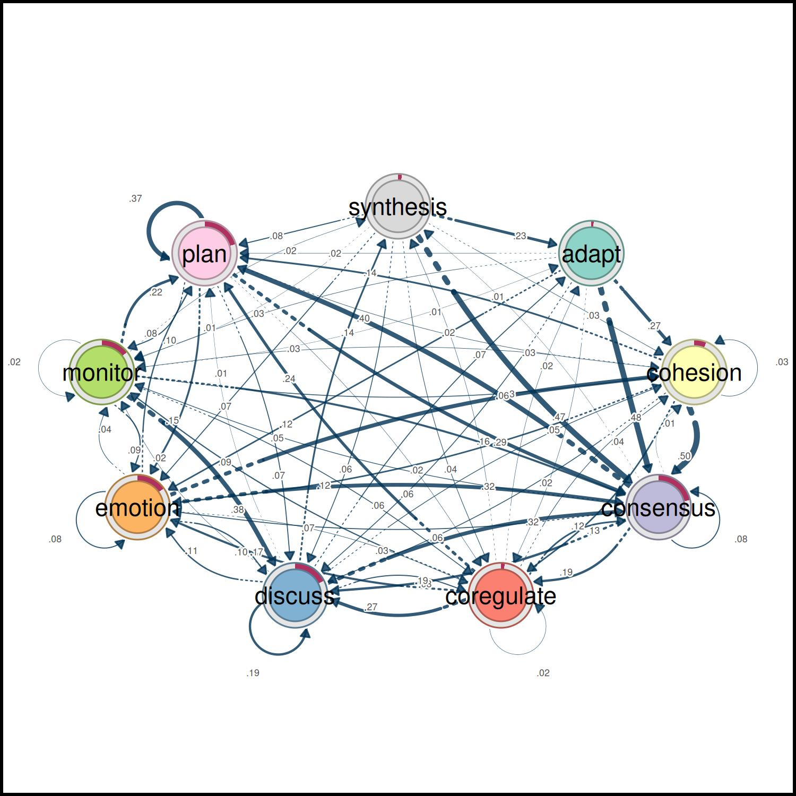
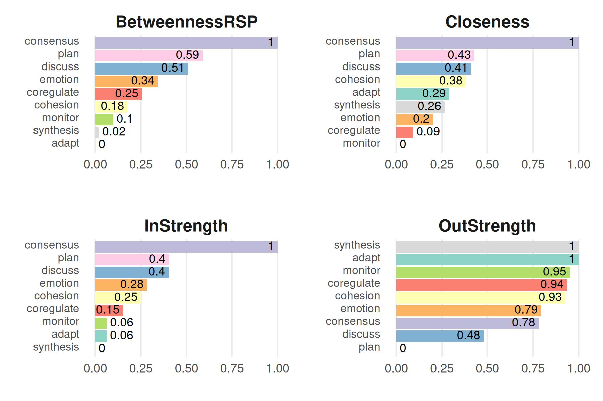

# Getting started with the tna package

This vignette showcases some basic usage of the `tna` package. For more
tutorials, please visit [the package website](https://sonsoles.me/tna/).

First we load the package.

``` r

library("tna")
```

We also load the `group_regulation` data available in the package (see
[`?group_regulation`](https://sonsoles.me/tna/reference/group_regulation.md)
for further information)

``` r

data("group_regulation", package = "tna")
```

We build a TNA model using this data with the
[`tna()`](https://sonsoles.me/tna/reference/build_model.md) function.
Each row of the data is one sequence of coded actions of a student, and
the model estimates the probability of moving from each action to the
next.

``` r

tna_model <- tna(group_regulation)
```

To visualize the model, we can use the standard
[`plot()`](https://rdrr.io/r/graphics/plot.default.html) function.

``` r

plot(tna_model)
#> Registered S3 method overwritten by 'cograph':
#>   method             from
#>   plot.tna_bootstrap tna
```



Printing the model shows the transition probabilities (row: from,
column: to) and the initial state probabilities, which tell how the
sequences tend to start.

``` r

print(tna_model, digits = 2)
#> State Labels : 
#> 
#>    adapt, cohesion, consensus, coregulate, discuss, emotion, monitor, plan, synthesis 
#> 
#> Transition Probability Matrix :
#> 
#>              adapt cohesion consensus coregulate discuss emotion monitor  plan
#> adapt      0.00000    0.273     0.477      0.022   0.059   0.120   0.033 0.016
#> cohesion   0.00295    0.027     0.498      0.119   0.060   0.116   0.033 0.141
#> consensus  0.00474    0.015     0.082      0.188   0.188   0.073   0.047 0.396
#> coregulate 0.01624    0.036     0.135      0.023   0.274   0.172   0.086 0.239
#> discuss    0.07137    0.048     0.321      0.084   0.195   0.106   0.022 0.012
#> emotion    0.00247    0.325     0.320      0.034   0.102   0.077   0.036 0.100
#> monitor    0.01117    0.056     0.159      0.058   0.375   0.091   0.018 0.216
#> plan       0.00097    0.025     0.290      0.017   0.068   0.147   0.076 0.374
#> synthesis  0.23466    0.034     0.466      0.044   0.063   0.071   0.012 0.075
#>            synthesis
#> adapt         0.0000
#> cohesion      0.0035
#> consensus     0.0076
#> coregulate    0.0188
#> discuss       0.1410
#> emotion       0.0028
#> monitor       0.0161
#> plan          0.0018
#> synthesis     0.0000
#> 
#> Initial Probabilities : 
#> 
#>      adapt   cohesion  consensus coregulate    discuss    emotion    monitor 
#>      0.011      0.060      0.214      0.019      0.175      0.151      0.144 
#>       plan  synthesis 
#>      0.204      0.019
```

[`summary()`](https://rdrr.io/r/base/summary.html) gives the
network-level metrics of the model as a table.

``` r

summary(tna_model)
#> # A tibble: 13 × 2
#>    metric                         value
#>  * <chr>                          <dbl>
#>  1 Node Count                  9   e+ 0
#>  2 Edge Count                  7.8 e+ 1
#>  3 Network Density             1   e+ 0
#>  4 Mean Distance               4.72e- 2
#>  5 Mean Out-Strength           1   e+ 0
#>  6 SD Out-Strength             8.07e- 1
#>  7 Mean In-Strength            1   e+ 0
#>  8 SD In-Strength              6.80e-17
#>  9 Mean Out-Degree             8.67e+ 0
#> 10 SD Out-Degree               7.07e- 1
#> 11 Centralization (Out-Degree) 1.56e- 2
#> 12 Centralization (In-Degree)  1.56e- 2
#> 13 Reciprocity                 9.86e- 1
```

The function
[`centralities()`](https://sonsoles.me/tna/reference/centralities.md)
computes various centrality measures (see
[`?centralities`](https://sonsoles.me/tna/reference/centralities.md) for
more information), which identify the actions that the process passes
through (betweenness), that are reached quickly from the others
(closeness), or that receive (in-strength) or lead to (out-strength)
many transitions. These measures can also be visualized with the
[`plot()`](https://rdrr.io/r/graphics/plot.default.html) function.

``` r

centrality_measures <- c("BetweennessRSP", "Closeness", "InStrength", "OutStrength")
cents_withoutloops <- centralities(
  tna_model,
  measures = centrality_measures,
  loops = FALSE,
  normalize = TRUE
)
plot(cents_withoutloops, ncol = 2)
```



## More tutorials

**Package articles** · [sonsoles.me/tna](https://sonsoles.me/tna/)

- [Getting started with tna](https://sonsoles.me/tna/articles/tna.html)
  — build, plot, and summarize a transition network
- [Preparing data](https://sonsoles.me/tna/articles/prepare_data.html) —
  turn event logs into sequences with
  [`prepare_data()`](https://sonsoles.me/tna/reference/prepare_data.md)
- [A showcase of the main
  functions](https://sonsoles.me/tna/articles/complete_tutorial.html) —
  models, centralities, communities, and validation
- [Grouped sequence
  data](https://sonsoles.me/tna/articles/grouped_sequences.html) — build
  and compare networks of groups
- [Cliques and
  communities](https://sonsoles.me/tna/articles/communities_and_cliques.html)
  — find the densely connected states
- [Frequency-based TNA](https://sonsoles.me/tna/articles/ftna.html) —
  model transition counts instead of probabilities
- [Attention TNA](https://sonsoles.me/tna/articles/atna.html) —
  accumulate transitions across temporal distances
- [Validating a transition
  network](https://sonsoles.me/tna/articles/model-validation.html) —
  Markov order, bootstrap, case-dropping, reliability, and permutation
  tests
- [Function reference
  sheet](https://sonsoles.me/tna/articles/new-docs.html) — every
  function with its arguments and an example

**Tutorials** · [sonsoles.me](https://sonsoles.me/)

- [A comprehensive TNA
  tutorial](https://sonsoles.me/posts/tna-tutorial/) — an updated
  walkthrough of transition network analysis
- [Data preparation](https://sonsoles.me/posts/tna-data/) — from raw
  event data to sequences
- [Comparing models](https://sonsoles.me/posts/tna-compare/) — network
  comparison of TNA models
- [Clustering](https://sonsoles.me/posts/tna-clustering/) — discover and
  analyze clusters of sequences
- [Group analysis](https://sonsoles.me/posts/tna-group/) — permutation
  tests, bootstrapping, and clusters

**Book chapters** · *Advanced Learning Analytics Methods*

- [Mapping relational dynamics with
  TNA](https://lamethods.org/book2/chapters/ch15-tna/ch15-tna.html) — a
  primer and tutorial
- [Frequency transition network
  analysis](https://lamethods.org/book2/chapters/ch16-ftna/ch16-ftna.html)
  — a primer and tutorial on FTNA
- [Mining patterns and clusters with
  TNA](https://lamethods.org/book2/chapters/ch17-tna-clusters/ch17-tna-clusters.html)
  — a heterogeneity approach

**Dynalytics** · [dynasite.org](https://dynasite.org/)

- [Package sites](https://pak.dynasite.org/) — documentation of the R
  packages of the Dynalytics framework
- [Tools](https://dynasite.org/#/tools) — interactive web apps, jamovi,
  and Python
- [CarmNotes](https://dynasite.org/carmnotes) — single-file notebooks
  that run the analyses in the browser, even offline
- [Selected articles](https://dynasite.org/#/papers) — publications on
  the framework and its methods
